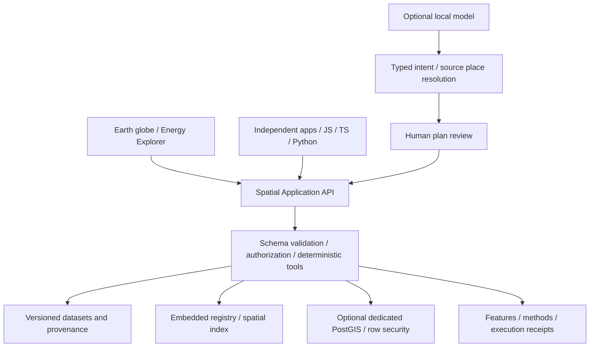

# Finalverse Earth

**An open spatial intelligence platform for people, AI agents and applications.**

Explore the planet, ask geographic questions, and trace every result to real data, a coordinate system and a reproducible method. Our goal is to make Earth a shared interface for understanding places, infrastructure, environments and change over time.

Finalverse Earth is part of the Finalverse ecosystem and works independently. It does not require a MutSea server, a social-world account, a hosted model, proprietary credentials or paid map tiles.

## What you can do today

**Core v0.2 is experimental software for local development.** The Energy Explorer is the first industry application, using an openly licensed, archival Canadian power-facility catalog.

- Explore a Cesium globe with 260 country/map units and 1,159 Canadian power facilities.
- Ask **“Show renewable-energy facilities within 100 km of Montréal.”** Review the typed plan, then run it against source data.
- Select facilities, inspect reported capacity and location sources, compare ellipsoidal distances, toggle layers and export evidence JSON.
- Use the same deterministic spatial tools from the browser, JavaScript, TypeScript or Python, with no model required.
- Convert explicit WGS84, ECEF and local ENU coordinates. Query distance, buffers, containment, intersections, nearest features, bounding boxes and spatial joins.
- Optionally persist datasets in a dedicated PostgreSQL/PostGIS database with row security and immutable dataset registration.

The default globe shows reference geometry on an ellipsoid. It does **not** provide satellite imagery, terrain or live energy observations. WRI's catalog is a 2021 release that stopped receiving maintenance in early 2022; reporting years and location quality vary. These records are not a current or complete facility census.


## Start locally

Use **Node 24.14 or later in the 24.x line**, npm, and a WebGL-capable browser. Node 24 is required for the inherited allocation regression tests.

```sh
git clone https://github.com/finalverse/finalverse-earth.git
cd finalverse-earth
npm ci --ignore-scripts
npm run earth:build
npm run earth:start
```

Open **http://127.0.0.1:18640/energy.html** for the Energy Explorer, or **http://127.0.0.1:18640/** for the country workspace. The Montréal example runs deterministically without AI. Click a result to inspect its source record and distance line; **Export evidence JSON** includes the plan, provenance and execution receipt.

Installation needs internet access. The default runtime uses pinned, bundled datasets and makes no map-provider requests. The listener binds to loopback only; this is not a publicly hosted multi-user service.

### Optional local AI

Install [Ollama](https://ollama.com/) separately and download the example model:

```sh
ollama pull llama3.2:3b
npm run earth:start -- --ai
```

In Energy Explorer, select **Propose a spatial query**. Review the dataset, source place ID, radius and fuel filters, then select **Run reviewed plan**. Countries, Canadian city-distance queries and nearest-facility queries are supported. Ambiguous or unsupported questions fail instead of inventing locations. The default example returns 24 matching facilities in the pinned snapshot; this is a catalog result, not a live observation.

Question text goes to the explicitly enabled local Ollama endpoint. The model proposes intent; trusted code resolves source places and executes bounded tools. No model-generated SQL, code or coordinates are executed. The provider contract is replaceable; cloud providers are not implemented in this release.

### Headless API and SDK

```sh
npm run earth:headless
# In another terminal:
node earth/examples/energy-lookup.mjs
python3 earth/examples/energy_lookup.py
```

A direct JavaScript query from the repository:

```js
import { EarthClient } from './earth/sdk.js';
const earth = new EarthClient('http://127.0.0.1:18640');
const result = await earth.spatialQuery('within_distance', {
  dataset: 'wri-canada-power-plants',
  place_id: 'ne-place-1173', // Montréal in the pinned Natural Earth catalog
  radius_m: 100000,
  fuels: ['Biomass', 'Geothermal', 'Hydro', 'Solar', 'Wave and Tidal', 'Wind'],
  limit: 100,
});
console.log(result.data.total, result.receipt.plan_sha256);
```

The independent application at `/examples/country-explorer.html` uses the same API without loading Cesium. Existing v0.1 country-lookup examples and SDK methods remain supported. See the [API reference](docs/earth/api.md) for contracts, limits, coordinates and registration permissions. The SDK is available as repository source; no public npm/PyPI package is promised.

### Optional PostGIS and dataset registration

The embedded backend is sufficient for the standalone demo. For persistent datasets, use the isolated development setup in the [database guide](docs/earth/database.md):

```sh
npm run earth:db:start
EARTH_DATABASE_URL_FILE="$HOME/.local/share/finalverse-earth/postgis-dev/runtime-url" \
  npm run earth:start -- --postgis
```

Pull the pinned official PostGIS image first, as documented. The helper creates only the named Earth development container/volume, listens on `127.0.0.1:18643`, and stores generated credentials in private files outside Git. `npm run earth:db:stop` stops that container while retaining data. No MutSea or other product's tables are reused.

Dataset registration is disabled for anonymous callers. An operator can enable a private bearer-token file and use the SDK registration API. This is a local operator capability, not public signup or a plugin sandbox. See [security boundaries](docs/earth/security.md) before configuring it.

## Architecture



The globe foundation is maintained in [finalverse/gods-eye-view](https://github.com/finalverse/gods-eye-view). Earth pins reviewed source and renderer dependencies; builds do not fetch the original upstream. The headless core imports no browser or Cesium runtime. Proj4js, GeographicLib, Turf and PostGIS supply established coordinate and geometry operations.

[Architecture and decisions](docs/earth/architecture.md) · [Maintained dependency workflow](docs/earth/upstream.md) · [API](docs/earth/api.md) · [Security](docs/earth/security.md) · [Verification and performance](docs/earth/verification.md)

## Vision and delivery plan

The destination is a spatial application platform where an analyst, researcher, creator or AI agent can use the same world model and explainable tools. Finalverse social worlds and MutSea can connect through explicit adapters; Earth Core remains independently usable.

| Milestone                              | Scope                                                                                                         | State                                                        |
| -------------------------------------- | ------------------------------------------------------------------------------------------------------------- | ------------------------------------------------------------ |
| v0.1 · Independent core                | Standalone globe, country queries, coordinate contracts, local AI and SDK                                     | Implemented baseline                                         |
| v0.2 · Spatial Intelligence Foundation | Real facility data, typed spatial analysis, optional PostGIS, grounded local planning and Energy Explorer     | Current experimental implementation; see verification report |
| v0.3 · Unified Space-Time Intelligence | Observation timestamps, historical layers, temporal comparisons, versioned workspaces and simulation adapters | Proposed, not implemented                                    |
| v0.4 · Application platform            | Distributable SDKs, permissioned application manifests, plugin isolation and independent industry apps        | Planned                                                      |
| Ecosystem integration                  | Optional geographic anchors and explicit links to persistent Finalverse/MutSea experiences                    | Limited fictional-destination adapter today                  |

GeoParquet, OGC services, streaming observations, generalized multi-step AI reasoning and a public multi-user cloud are future work. Roadmap entries describe direction, not shipped capabilities. Read the [implementation proposal and acceptance gates](docs/earth/roadmap.md).

## Develop and verify

```sh
npm run earth:test           # defaults to embedded tests; PostGIS test skips without explicit test URL files
npm run check:boundaries
npm run earth:bench
npm run earth:build
npm run earth:audit-build
npm test                    # inherited upstream regression suite
npm run build               # maintained upstream application, separate dist/
```

The database guide documents the opt-in PostGIS integration suite. Tests cover coordinate references, antimeridian cases, topology, source checksums, deterministic planning, private-layer access, rollback, SDK compatibility and transport limits. See the verification report for checks actually run and remaining browser/device limitations. A successful build alone is not release acceptance.

## Data, licensing and contribution

- **Source code:** [MIT](LICENSE.finalverse) for new Earth code; inherited [MIT license and copyright notices](LICENSE) remain intact. The original globe was created by [Bilawal Sidhu and contributors](https://github.com/bilawalsidhu/gods-eye-view); our maintained foundation preserves that history.
- **Country/place references:** [Natural Earth](https://www.naturalearthdata.com/about/terms-of-use/), public domain, pinned source versions and explicit curation.
- **Canadian power facilities:** World Resources Institute's [Global Power Plant Database v1.3.0](https://github.com/wri/global-power-plant-database), **CC BY 4.0**, with attribution, source hashes and modifications recorded in the [data notice](earth/data/NOTICE.md).

Source-code licensing does not grant rights to unrelated upstream feeds, images, models or brands. The Earth build excludes the inherited public asset tree. Review [third-party notices](THIRD_PARTY_NOTICES.md) and the [license audit](docs/earth/licensing.md) before redistribution.

Contributions should include a reproducible example, source/license information, explicit coordinates and meaningful contract tests. Preserve working subsystems, provenance and privacy. Do not embed credentials, silently fall back to hosted providers, or present static/inferred data as live observations. Report security concerns privately to maintainers, without publishing secrets or private location data.
