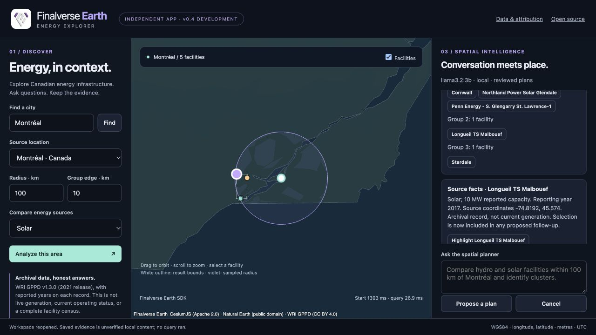
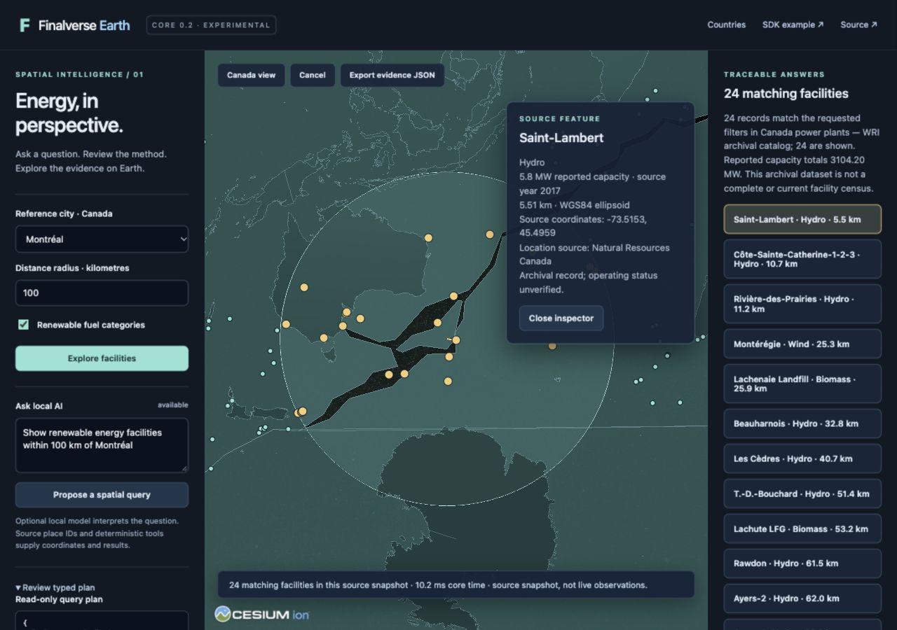
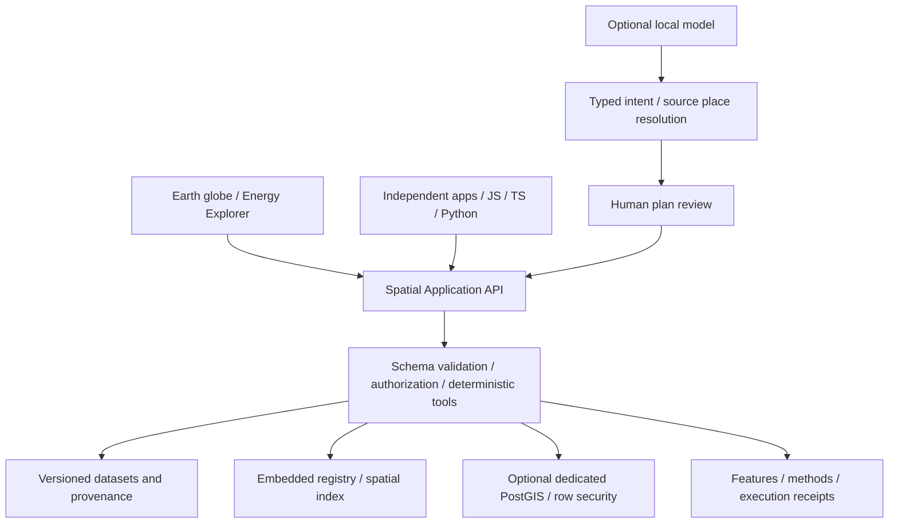

# Finalverse Earth

**v0.3 public preview:** [Launch the application](https://earth.finalverse.com) · [Product page](https://finalverse.com/earth) · [Getting started](docs/earth/public-preview.md) · [Release evidence](docs/earth/verification-v03.md). No account or AI key required. This is a preview, not GA.

[](https://github.com/finalverse/finalverse-earth/actions/workflows/earth.yml)

**An open spatial intelligence platform for people, AI agents and applications.**

Explore the planet, ask geographic questions, and trace every result to real data, a coordinate system and a reproducible method. Our goal is to make Earth a shared interface for understanding places, infrastructure, environments and change over time.

Finalverse Earth is part of the Finalverse ecosystem and works independently. It does not require a MutSea server, a social-world account, a hosted model, proprietary credentials or paid map tiles.

## v0.7 Confluence integration · local R&D

Cross-product acceptance is recorded in the [canonical P0 ledger](https://github.com/finalverse/finalverse/blob/main/integration/acceptance/p0.json).
The actual Desktop now presents native meshes and a bounded textured primitive
through FinalStorm. This does not by itself accept Earth destination resolution,
published geographic world placement or shared-session Lumi. Those remain
separate application gates; the existing canonical conversation store and
WorldKernel authority are retained.

The `codex/confluence-v07` integration branch connects **one existing Intelligence
session** to Earth CLI, the local Web view and the native Finalverse Viewer.
Explicit, expiring participant grants allow source inspection and bounded
conversation; they never grant world approval or editing authority. Native
identity, canonical event replay, model identity, immutable artifact references
and revocation use the existing runtime, PostgreSQL and MutSea capability relay.

Real local-model conversation, two simultaneous native accounts, source-backed
workspace recovery and approved 94-part exhibition creation/Undo have been
verified. **This is not a completed v0.7 release.** Shared-session Lumi, additional
artifact producers and the broader performance gates remain open. See the
[architecture](docs/finalverse/v07/architecture.md),
[acceptance and evidence](docs/finalverse/v07/acceptance.md) and
[local operator guide](docs/finalverse/v07/operator-guide.md). Public Earth and
downloadable viewer packages have not been silently upgraded.

## v0.6 local integration: Earth → persistent worlds

The development branch adds **FSIP 0.1** and an opt-in bridge inside the existing
Rust runtime. An owned Earth workspace can become a reviewed, source-linked native
MutSea place through a one-use identity handoff, native policy checks, WorldLine
and guarded Undo. The same contract supports a virtual-only garden without an
Earth dataset. The existing viewer, renderer and world protocols are preserved.

This is **not a public release**. Local native creation, scene display,
independent observation, restart, Undo and frame measurements pass. Hosted Lumi
and the post-upgrade Harbor smoke remain open; v0.7 is gated on acceptance. See the [operator/developer guide](docs/earth/bridge-v06/developer-guide.md),
[architecture](docs/earth/bridge-v06/architecture.md),
[acceptance ledger](docs/earth/bridge-v06/acceptance.md),
[rollback](docs/earth/bridge-v06/rollback.md), and [FSIP schema/types](earth/fsip/README.md).

## v0.5 development preview: Earth Intelligence

A separately testable **Rust runtime and native `earth` CLI** connect conversation,
source-grounded spatial plans and explicitly approved coding tools through owned
PostgreSQL sessions. Local Ollama streaming, hash-bound approvals, execution
receipts, restart-safe replay and scoped browser workspace continuation are
implemented. The Node Earth API remains the deterministic spatial authority.

This is a **local developer preview**. The public v0.3 site is unchanged; no public
AI service, cloud fallback or autonomous shell is enabled. The opt-in local
viewer bridge is described separately above.
Start with the [native runtime and CLI guide](docs/earth/intelligence/developer-guide.md),
[architecture/protocol](docs/earth/intelligence/architecture.md),
[security boundaries](docs/earth/intelligence/security.md),
[acceptance and performance](docs/earth/intelligence/acceptance.md), and
[v0.6 roadmap](docs/earth/intelligence/roadmap-v06.md).

```sh
cargo build --locked --manifest-path earth/intelligence/Cargo.toml
cargo test --locked --manifest-path earth/intelligence/Cargo.toml
```

## v0.4 release candidate: independent spatial applications

The consolidated `main` branch includes a strict, renderer-independent **`@finalverse/earth`** SDK tarball, OpenAPI 3.1, server-owned application grants, local workspaces and ordered intelligence sessions. Its independent **Energy Explorer** demonstrates source-backed geographic grouping, fuel comparisons, selected map/conversation artifacts and optional reviewed local AI plans.

These contracts and the independent app are **release-candidate artifacts**, not installed on the unchanged public v0.3 service. No npm package has been published. Start with the [SDK quickstart](docs/earth/platform/quickstart.md), [independent application build/tutorial](apps/energy-explorer/README.md), [intelligence architecture](docs/earth/platform/intelligence-v04.md) and [v0.4 acceptance and release assessment](docs/earth/platform/acceptance-v04b.md).

```sh
npm ci --ignore-scripts
npm run earth:sdk:build
npm ci --prefix apps/energy-explorer --ignore-scripts
npm test --prefix apps/energy-explorer
npm run build --prefix apps/energy-explorer
node earth/platform/serve.mjs --manifest apps/energy-explorer/earth-app.json --grant earth/platform/dev-grants/energy-explorer.json --web-root apps/energy-explorer/dist --port 18644
```

Open <http://127.0.0.1:18644/>. Add `--ai` only for optional local Ollama. An application manifest requests permissions; a separate operator-owned installation grants them. Only reviewed trusted same-origin applications are supported; this runtime is not a remote plugin sandbox or multi-tenant identity service.



The RC adds a full application bundle, standalone SDK and Energy Explorer
packages, SHA-256 manifests, CycloneDX inventory, license notices and extracted
installation/rollback rehearsal. See the [RC audit](docs/earth/releases/v04-rc-audit.md),
[release validation](docs/earth/releases/v04-rc-validation.md) and
[installation/upgrade guide](earth/release/README.md). Build candidates locally:

```sh
npm run earth:build
npm run earth:energy:package
npm run earth:release:build
npm run earth:release:rehearse
```

Artifacts appear in `artifacts/release/`. Nothing is automatically published to
npm, GitHub Releases or the public service. The artifact startup command exposes
public read-only data with AI disabled; development AI remains explicitly opt-in.

## What you can do today

**Core v0.3 is a read-only public preview, also available for local development.** The Energy Explorer is the first industry application, using an openly licensed, archival Canadian power-facility catalog.

- Explore a Cesium globe with 260 country/map units and 1,159 Canadian power facilities.
- Ask **“Show renewable-energy facilities within 100 km of Montréal.”** Review the typed plan, then run it against source data.
- Select facilities, inspect reported capacity and location sources, compare ellipsoidal distances, toggle layers and export evidence JSON.
- Use the same deterministic spatial tools from the browser, JavaScript, TypeScript or Python, with no model required.
- Convert explicit WGS84, ECEF and local ENU coordinates. Query distance, buffers, containment, intersections, nearest features, bounding boxes and spatial joins.
- Explore 90 archived USGS earthquake events, scrub a UTC timeline, compare source snapshots and export evidence.
- Save, reopen, duplicate and exchange versioned workspaces on your own device.
- Optionally persist datasets in a dedicated PostgreSQL/PostGIS database with row security and immutable dataset registration.

The default globe shows reference geometry on an ellipsoid. It does **not** provide satellite imagery, terrain or live energy observations. WRI's catalog is a 2021 release that stopped receiving maintenance in early 2022; reporting years and location quality vary. These records are not a current or complete facility census.



## Start locally

Use **Node 24.14 or later in the 24.x line**, npm, and a WebGL-capable browser. Node 24 is required for the inherited allocation regression tests.

```sh
git clone https://github.com/finalverse/finalverse-earth.git
cd finalverse-earth
npm ci --ignore-scripts
npm run earth:build
npm run earth:start
```

Open **http://127.0.0.1:18640/energy.html** for the Energy Explorer, or **http://127.0.0.1:18640/** for the country workspace. The Montréal example runs deterministically without AI. Click a result to inspect its source record and distance line; **Export evidence JSON** includes the plan, provenance and execution receipt.

Installation needs internet access. The default runtime uses pinned, bundled datasets and makes no map-provider requests. The local listener binds to loopback only. The public preview uses a separate hardened HTTPS deployment; private datasets and local workspaces are not shared through that service.

### Optional local AI

Install [Ollama](https://ollama.com/) separately and download the example model:

```sh
ollama pull llama3.2:3b
npm run earth:start -- --ai
```

In Energy Explorer, select **Propose a spatial query**. Review the dataset, source place ID, radius and fuel filters, then select **Run reviewed plan**. Countries, Canadian city-distance queries and nearest-facility queries are supported. Ambiguous or unsupported questions fail instead of inventing locations. The default example returns 24 matching facilities in the pinned snapshot; this is a catalog result, not a live observation.

Question text goes to the explicitly enabled local Ollama endpoint. The model proposes intent; trusted code resolves source places and executes bounded tools. No model-generated SQL, code or coordinates are executed. The provider contract is replaceable; cloud providers are not implemented in this release.

### Headless API and SDK

```sh
npm run earth:headless
# In another terminal:
node earth/examples/energy-lookup.mjs
python3 earth/examples/energy_lookup.py
```

A direct JavaScript query from the repository:

```js
import { EarthClient } from './earth/sdk.js';
const earth = new EarthClient('http://127.0.0.1:18640');
const result = await earth.spatialQuery('within_distance', {
  dataset: 'wri-canada-power-plants',
  place_id: 'ne-place-1173', // Montréal in the pinned Natural Earth catalog
  radius_m: 100000,
  fuels: ['Biomass', 'Geothermal', 'Hydro', 'Solar', 'Wave and Tidal', 'Wind'],
  limit: 100,
});
console.log(result.data.total, result.receipt.plan_sha256);
```

The independent application at `/examples/country-explorer.html` uses the same API without loading Cesium. Existing v0.1 country-lookup examples and SDK methods remain supported. See the [API reference](docs/earth/api.md) for contracts, limits, coordinates and registration permissions. The SDK is available as repository source; no public npm/PyPI package is promised.

### Optional PostGIS and dataset registration

The embedded backend is sufficient for the standalone demo. For persistent datasets, use the isolated development setup in the [database guide](docs/earth/database.md):

```sh
npm run earth:db:start
EARTH_DATABASE_URL_FILE="$HOME/.local/share/finalverse-earth/postgis-dev/runtime-url" \
  npm run earth:start -- --postgis
```

Pull the pinned official PostGIS image first, as documented. The helper creates only the named Earth development container/volume, listens on `127.0.0.1:18643`, and stores generated credentials in private files outside Git. `npm run earth:db:stop` stops that container while retaining data. No MutSea or other product's tables are reused.

Dataset registration is disabled for anonymous callers. An operator can enable a private bearer-token file and use the SDK registration API. This is a local operator capability, not public signup or a plugin sandbox. See [security boundaries](docs/earth/security.md) before configuring it.

## Architecture



The globe foundation is maintained in [finalverse/gods-eye-view](https://github.com/finalverse/gods-eye-view). Earth pins reviewed source and renderer dependencies; builds do not fetch the original upstream. The headless core imports no browser or Cesium runtime. Proj4js, GeographicLib, Turf and PostGIS supply established coordinate and geometry operations.

[Architecture and decisions](docs/earth/architecture.md) · [Maintained dependency workflow](docs/earth/upstream.md) · [API](docs/earth/api.md) · [Security](docs/earth/security.md) · [Verification and performance](docs/earth/verification.md)

## Vision and delivery plan

The destination is a spatial application platform where an analyst, researcher, creator or AI agent can use the same world model and explainable tools. Finalverse social worlds and MutSea can connect through explicit adapters; Earth Core remains independently usable.

| Milestone                              | Scope                                                                                                     | State                                           |
| -------------------------------------- | --------------------------------------------------------------------------------------------------------- | ----------------------------------------------- |
| v0.1 · Independent core                | Standalone globe, country queries, coordinate contracts, local AI and SDK                                 | Implemented baseline                            |
| v0.2 · Spatial Intelligence Foundation | Real facility data, typed spatial analysis, optional PostGIS, grounded local planning and Energy Explorer | Implemented foundation; see verification report |
| v0.3 · Unified Space-Time Intelligence | Source timestamps, historical layers, bounded temporal comparisons and portable local workspaces          | Public preview; see v0.3 evidence               |
| v0.4 · Application platform            | Distributable SDKs, permissioned application manifests, trusted application grants and independent industry apps | RC validation; public v0.3 unchanged                                         |
| Ecosystem integration                  | Optional geographic anchors and explicit links to persistent Finalverse/MutSea experiences                | Limited fictional-destination adapter today     |

GeoParquet, OGC services, streaming observations, generalized multi-step AI reasoning and a public multi-user cloud are future work. Roadmap entries describe direction, not shipped capabilities. Read the [implementation proposal and acceptance gates](docs/earth/roadmap.md).

## Develop and verify

```sh
npm run earth:test           # defaults to embedded tests; PostGIS test skips without explicit test URL files
npm run check:boundaries
npm run earth:bench
npm run earth:build
npm run earth:audit-build
npm test                    # inherited upstream regression suite
npm run build               # maintained upstream application, separate dist/
```

The database guide documents the opt-in PostGIS integration suite. Tests cover coordinate references, antimeridian cases, topology, source checksums, deterministic planning, private-layer access, rollback, SDK compatibility and transport limits. See the verification report for checks actually run and remaining browser/device limitations. A successful build alone is not release acceptance.

## Data, licensing and contribution

- **Source code:** [MIT](LICENSE.finalverse) for new Earth code; inherited [MIT license and copyright notices](LICENSE) remain intact. The original globe was created by [Bilawal Sidhu and contributors](https://github.com/bilawalsidhu/gods-eye-view); our maintained foundation preserves that history.
- **Country/place references:** [Natural Earth](https://www.naturalearthdata.com/about/terms-of-use/), public domain, pinned source versions and explicit curation.
- **Historical earthquakes:** USGS ComCat Ridgecrest archive, 90 events acquired and checksum-pinned; original event times and later catalog-update times remain distinct. This is not a live hazard service.
- **Canadian power facilities:** World Resources Institute's [Global Power Plant Database v1.3.0](https://github.com/wri/global-power-plant-database), **CC BY 4.0**, with attribution, source hashes and modifications recorded in the [data notice](earth/data/NOTICE.md).

Source-code licensing does not grant rights to unrelated upstream feeds, images, models or brands. The Earth build excludes the inherited public asset tree. Review [third-party notices](THIRD_PARTY_NOTICES.md) and the [license audit](docs/earth/licensing.md) before redistribution.

Contributions should include a reproducible example, source/license information, explicit coordinates and meaningful contract tests. Preserve working subsystems, provenance and privacy. Do not embed credentials, silently fall back to hosted providers, or present static/inferred data as live observations. Report security concerns privately to maintainers, without publishing secrets or private location data.

## Space-time intelligence · v0.3

After starting the app, open [Space-Time](http://127.0.0.1:18640/time.html). Play the pinned July 2019 Ridgecrest sequence, inspect the 90 source events, compare cumulative snapshots and export the evidence. Save/open/duplicate/import/export a workspace on your own device. The supplied Finalverse symbol, responsive themes and accessible source credits replace the placeholder identity. The independent build uses no Cesium ion services.

The Canadian energy archive has **no populated reported annual generation values**. Energy Explorer now makes that coverage gap inspectable, rather than inventing output from capacity. Historical event time, observation time, ingestion time and catalog updates remain distinct. Missing measurements never imply zero output, creation or deletion.

Seven new temporal tools use the existing read-only, reviewed-plan API. See [space-time contracts](docs/earth/space-time.md), [LayerProvider metadata](http://127.0.0.1:18640/v1/providers), [preview deployment](docs/earth/deployment.md) and [local benchmark](docs/earth/benchmark-v03-temporal.json). Headless use remains independent of rendering, accounts, hosted AI and MutSea.

Public application: [earth.finalverse.com](https://earth.finalverse.com). Product page: [finalverse.com/earth](https://finalverse.com/earth). The preview runs anonymously with hosted AI disabled; local Ollama planning remains opt-in. v0.4 candidate work adds the spatial application SDK, reviewed local provider adapter and application discovery. The new Rust intelligence runtime is a separate v0.5 milestone; collaboration and world handoff remain future capabilities.
