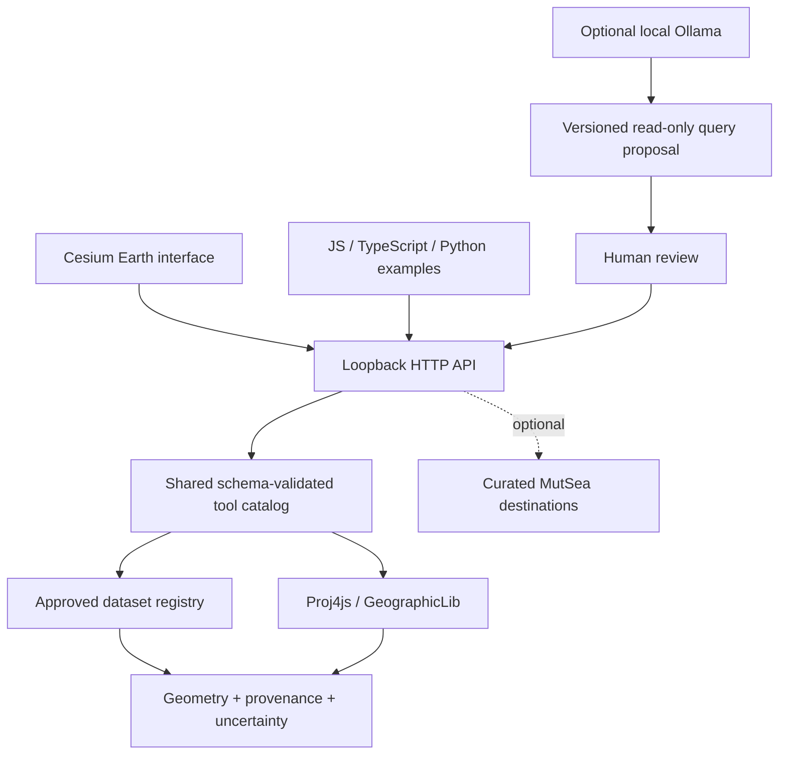

# Independent Earth Core v0.1

Decision date: 2026-10-19. Latest user architecture establishes Earth as an independent platform; the existing viewer, MutSea, Studio and AI gateway are preserved. Their outstanding native conversation/layout/WorldLine review work remains a separate queue. The inherited npm package name is retained because its public self-imports and regression tests depend on it; Earth has separate exports and runtime versioning.

## Concrete boundaries

| Component             | Source                           | Responsibility                                                        |
| --------------------- | -------------------------------- | --------------------------------------------------------------------- |
| Core                  | `earth/core/index.js`            | Registry visibility, six read-only operators, bounded typed plans     |
| Geo                   | `earth/core/geo.js`              | Explicit WGS84/ECEF/ENU and opt-in GeoAnchor transforms               |
| Application contracts | `earth/core/application.js`      | Dataset/tool allowlists, result budget; no loaded plugin code         |
| HTTP                  | `earth/server/http.js`           | Loopback transport, host/origin/rate/body bounds, safe static serving |
| Planner               | `earth/server/planner.js`        | Local provider proposal; no executor privileges                       |
| Interface             | `earth/web/`                     | Globe, source inspection, result display and explicit plan review     |
| SDK                   | `earth/sdk.js`, `earth/sdk.d.ts` | Same HTTP tools for third-party applications                          |
| MutSea adapter        | `earth/adapters/mutsea.js`       | Optional public fictional destinations only                           |

No browser or Cesium dependency enters the headless core import graph. Upstream reuse is selective: `src/tools/catalog.js` and `schema.js` validate operations; `src/data/adminBoundaries.js` supplies tested geometry decoding/containment; `src/sources/httpBody.js` bounds model responses; `src/app/viewer.js` supplies Cesium initialization and Apple atmosphere compatibility. The whole upstream tool index is deliberately not imported, because it couples unrelated feeds and differently licensed datasets.

## Technology decisions

Cesium is already integrated upstream and handles geocentric rendering; retaining it minimizes migration risk. MapLibre is a strong map-oriented alternative and deck.gl a visualization layer, but replacing the working globe adds no v0.1 capability. Proj4js provides mature geocentric conversions; GeographicLib handles antipodal geodesics. ENU uses the standard ECEF tangent-frame rotation around an explicit ellipsoidal anchor. No spherical distance shortcut or invented projection is used.

The first dataset is bundled, pinned, generalized Natural Earth country/map-unit polygons. It needs no key, live feed, database or remote tile server. This isolates platform correctness from provider availability and terms. A 260-feature linear scan is intentional at this scale; benchmarks determine when to introduce an index or a database. PostgreSQL/PostGIS is a later option for large/multi-user registries, not a prerequisite for the independent core.

## Limitations

Point containment uses the inherited planar raycast on generalized lon/lat polygons, including holes. Points on edges have no guaranteed classification. Envelope queries are candidates, not exact polygon intersection. The globe uses geodesic tessellation to avoid rhumb-line singularities at polar source vertices; this display interpolation does not redefine the planar query model. No buffering, area analysis, route finding, raster processing, temporal playback, distributed query engine, world mutations or production plugin sandbox exists. The AI adapter supports country-name extraction only. UI review is enforced by the interface; external clients may directly call read-only queries.
