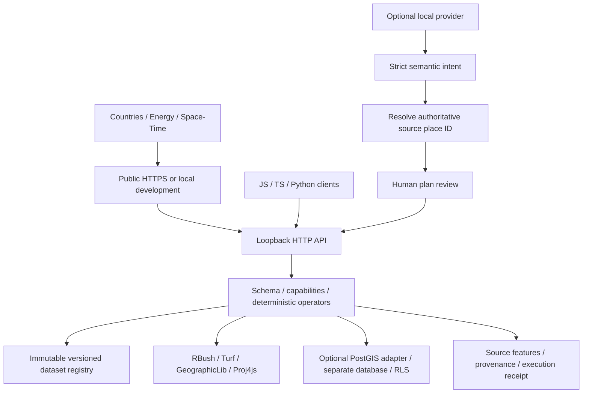

# Independent Earth Core v0.3

Finalverse Earth is a spatial intelligence platform with a standalone runtime. MutSea, Finalverse Social, the native viewer, Studio and the AI gateway remain independent systems; their existing work is preserved. The inherited npm package name/export map remains compatible, while Earth has its own core version and entry points.

## Implemented boundaries

| Component        | Source                                  | Responsibility                                                                       |
| ---------------- | --------------------------------------- | ------------------------------------------------------------------------------------ |
| Core/catalog     | `earth/core/index.js`                   | 25 schema-validated read-only operations; v0.1 compatibility                         |
| Registry         | `earth/core/registry.js`                | Public/owner visibility, immutable IDs, operator registration, lazy spatial indexes  |
| Geography        | `earth/core/geo.js`                     | WGS84/ECEF/ENU conversion, ellipsoidal distance, explicit optional GeoAnchors        |
| Spatial engine   | `earth/core/spatial.js`                 | Bounded topology/proximity/join operations, derived buffers, source place resolution |
| Receipt          | `earth/core/receipt.js`                 | Execution ID/time and canonical-plan SHA-256; exportable evidence, not WorldLine     |
| Database         | `earth/db/`                             | Optional PostGIS persistence, migrations, RLS and isolated development helper        |
| Data             | `earth/data/`                           | Pinned WRI/NE/USGS sources, checksums and reproducible curation                      |
| Transport        | `earth/server/http.js`                  | Host/origin/body/rate checks, operator bearer capability, safe static serving        |
| Planning         | `earth/server/planner.js`, `intents.js` | Replaceable proposal provider; validate semantic intent and resolve real places      |
| Applications     | `earth/web/`                            | Country, Energy and Space-Time workspaces; independent SDK example                   |
| Client contracts | `earth/sdk.js`, `sdk.d.ts`, `python/`   | Browser/headless access to the same API                                              |

No browser, Cesium or database dependency enters the embedded core import graph. The PostgreSQL adapter is loaded only when selected. Inherited tool/schema validation, geometry decoding and Cesium initialization are reused, not rewritten. Rendering assumptions and the 11 used upstream source/license/data files are pinned through the [maintained source workflow](upstream.md).

## Space-time and workspace additions

- `core/time.js` validates full UTC instants, half-open intervals and bounded temporal sidecars. `core/temporal.js` supplies seven read-only temporal tools, retaining event/observation/ingestion and catalog-update distinctions. Missing reports do not establish physical creation or deletion.
- `core/provider.js` and `data/providers.js` expose four reviewed provider contracts and checksum-verified bundled sources. This is an adapter interface, not arbitrary executable plugin loading.
- `core/workspace.js` owns the versioned document schema and bounded browser-local store; `web/workspaces.js` adapts camera/layer/plan/evidence state. Import collision creates a separate document; opening never executes a saved plan. Browser storage is not cloud persistence.
- The time application synchronizes a UTC cursor, bounded playback and reviewed interval/comparison tools. Saved receipts are distinguishable from refreshed results.

## Deployment boundary

The public preview uses a dedicated HTTPS proxy, rate/connection limits and a hardened unprivileged systemd service. Node listens on loopback; the proxy overwrites its client identity header. Public AI, operator registration, private metrics, database access and world mutations are unavailable. Local planning and isolated PostGIS are optional configurations, independent of the public embedded backend. See [accepted deployment](deployment.md) and [security boundaries](security.md).

## Design decisions

- **Preserve the working globe.** Cesium already handles geocentric display and the Mac atmosphere fix. Alternative renderers add no v0.2 proof; engine migration is not part of this milestone.
- **Use established geographic libraries.** GeographicLib handles ellipsoidal inverse/direct solutions, including the dateline. Proj4js handles WGS84/ECEF; ENU is the standard local tangent-frame rotation. Turf supplies 2D topology; RBush limits intersection/join candidates. Display buffers sample 128 geodesic bearings and split at the dateline using polygon-clipping.
- **Ship a bounded, real example.** 1,159 Canadian source facilities and 1,251 global place references need no keys or live feeds. The example is archival and its quality limits are visible. There is no inferred production/ownership/status.
- **Keep storage optional.** Embedded queries are adequate at this size. PostGIS adds durable registration and database access controls without pulling another product's database into Earth. [Database geometry derivation and index limitations](database.md) are explicit.
- **Constrain AI authority.** A model returns a small intent object, not executable code or free-form coordinates. Trusted code resolves Canadian places, builds typed plans and executes the same deterministic tools. Explanations are deterministic summaries of returned records; no second model adds geographic facts.
- **Version evidence, not screenshots alone.** Immutable dataset versions, source hashes, parameters, tool method and plan receipts make results reviewable. Receipts are not a durable distributed audit log; consumers can export them. Dataset manifests persist registration metadata in PostGIS.

## Boundaries still open

The public preview is read-only. There is no public multi-user identity/private-workspace cloud, untrusted plugin execution, streaming ingestion, raster analytics, route planning, general multi-step agent planner or live energy telemetry. Historical temporal analysis and anonymous reference-data publication are implemented; they are not those future services. GeoParquet/OGC adapters and distributable application SDKs are next milestones. Finalverse/MutSea mutations retain their own authorization/transaction systems and cannot be invoked by Earth query tools. Broader browser/device, sustained-load and operational support coverage remain preview limits.
