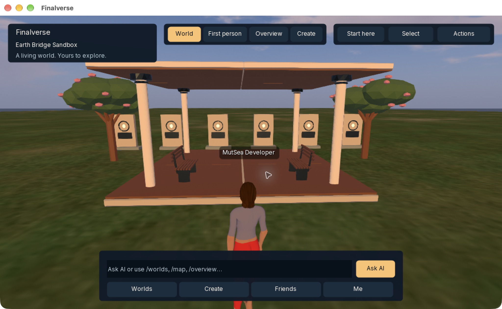
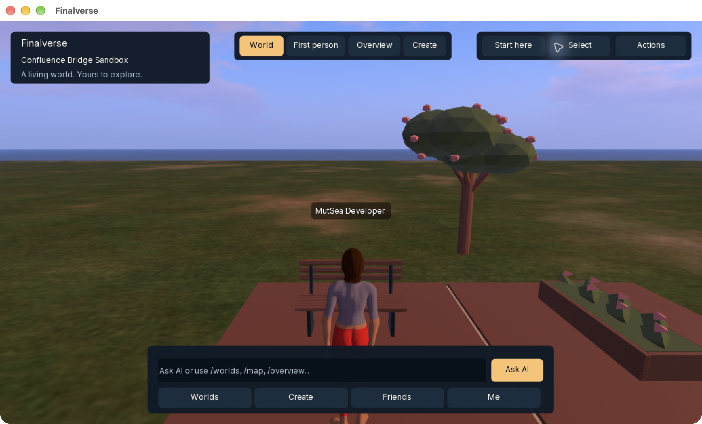
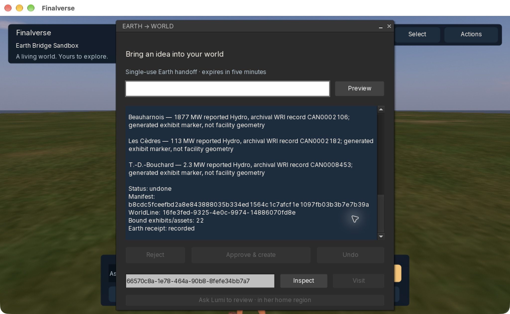

# v0.6 acceptance ledger

This is a live development ledger, not a release declaration. A gate is PASS only
when its recorded check has actually run against the corresponding implementation.

| Gate | Requirement | Status | Evidence |
|---|---|---|---|
| G01 | Existing v0.5 tests pass | PASS | Previous 12-job CI at a104a149; current local core 43/43 including PostGIS, platform 24/24, app 5/5, Rust/provider and explicit runtime integration pass. No v0.6 public CI run yet. |
| G02 | FSIP schemas validated | PASS | Generated JSON Schema/Rust/TypeScript; strict version and field rejection, AJV fixtures and TypeScript compilation; four Node FSIP tests and Rust schema test pass. |
| G03 | Geographic transforms verified | PASS | Antimeridian, polar, height, ECEF/ENU origin shifts, projected round-trip/domain refusal; live EPSG:4979 → 3857 query retains height and a read-only receipt. |
| G04 | Virtual-only coordinates supported | PASS | Real local-model Confluence proposal and native region creation without a source workspace, Earth dataset or geographic binding. |
| G05 | Earth workspace imported | PASS | Montréal proposal consumes the owned committed 18-facility WRI workspace; existing browser continuation retains that workspace and selection. |
| G06 | Source provenance retained | PASS | Six source-linked exhibits, artifact/execution SHA, archival WRI CC BY 4.0 data and separate generated CC0 geometry survive in manifest, semantic bindings and native receipt. |
| G07 | Authentication handoff verified | PASS | Real private owner CLI → one-use native handoff → current root avatar/session → native receipt; separate owner/service credentials. |
| G08 | Unauthorized operations rejected | PASS | Dedicated PostgreSQL integration checks wrong owner/actor/audience, expiry, revocation, replay and unknown-state fencing; actual HTTP checks role/Host/Origin boundaries and JSON/SSE replay. Native generic/repeated commit denials pass. |
| G09 | Manifest preview succeeds | PASS | Native preview validates approved asset pins, actual resource budget, terrain, clearance and parcel permissions in isolated regions. |
| G10 | Approval required | PASS | Explicit native commit after preview; same-login expiry checks and generic-route denial. No model or browser mutation authority. The actual native panel review/approval path also passes G12. |
| G11 | World creation succeeds | PASS | Montréal: 22 placements/94 native parts. Confluence: 10 placements/78 parts. Real Ollama, PostgreSQL, existing PlaceKernel and native streaming. |
| G12 | Native viewer displays objects | PASS | Real arm64 viewer: panel Preview → Approve → receipt → Visit → Inspect → Undo for the source-backed pavilion. Fresh private cache, Earth login and native-map teleport display persisted Confluence materials; zero failures among its 24 approved materials. [Pavilion](native-pavilion.png), [Confluence](native-confluence.png), [Undo](native-undo.png). |
| G13 | Independent observer sees experience | PASS | Separate Bridge Observer avatar sees all 94 pavilion objects and all 78 Confluence objects through actual native UDP. |
| G14 | Restart persistence | PASS | Native container and Rust service restart retain the pavilion; independent observer still sees 94/94. Confluence survives a second module restart and reconciles without replay. |
| G15 | Guarded Undo | PASS | First virtual rehearsal's owner Undo succeeds; separate observer sees 0/78 afterward while pavilion remains. Existing kernel fingerprint/rollback tests pass. Source-backed native panel Undo also passes: a separate observer sees 0/94 objects afterward; Earth records the native Undo receipt. |
| G16 | Existing Lumi proposes without bypass | NOT TESTED | Controller/read-only unit path passes in the existing runtime/gateway; actual hosted single-Lumi pilot has not run. |
| G17 | Existing Harbor content preserved | NOT TESTED | Hosted content was not modified. Current WorldTests 61/61 and ContentTests 54/54 pass; post-upgrade hosted Harbor smoke has not run. |
| G18 | Performance measured | PASS | Local native panel/scene run measured 102.9 FPS, mean frame 12.9 ms, median 9.2 ms, ping 9 ms and zero packet loss; protocol, mesh and memory samples below. One arm64 Mac/viewport only; no production load or device claim. |
| G19 | Rollback documented | PASS | [Rollback](rollback.md): preserve DB/WorldLine/FSIP journals, disable new handoffs, retain inspection/Undo, and coordinate any hosted upgrade. |
| G20 | Unrelated changes preserved | PASS | Clean integration worktrees isolated; dirty primary viewer excluded. |

No v0.7 promotion or public release is authorized by this ledger.

## Measured local evidence · 2026-10-21

These are single-run development samples on an M1 Mac with Docker Desktop and
loopback networking. They are not p95 latency, public-network throughput or a
production capacity benchmark. Private evidence files retain full correlation
IDs and native receipts outside Git; no handoff, account or service key is included
in this document.

| Observation | Measured result |
|---|---|
| Original virtual proposal, llama3.2:3b | 7,495 ms; 10 pinned placements, 78 native parts |
| Montréal proposal, llama3.2:3b | 7,002 ms; 22 placements, 94 parts, six source exhibits |
| Virtual native login/preview/approval/denials/receipt | 4,760 ms |
| Montréal login/site teleport/preview/approval/receipt | 9,477 ms |
| Independent pavilion observation after restart | 94/94 objects, 3,725 ms including login |
| Independent Confluence observation | 78/78 objects, 1,833 ms including login |
| Approved pavilion mesh delivery | 4,086 bytes; SHA verified; 180 ms HTTP sample |
| Independent observation after virtual Undo | 0/78 objects, 3,577 ms including login |
| Independent observation after native-panel pavilion Undo | 0/94 objects, 2,245 ms including login |
| Cold persisted Confluence material delivery | 24/24 approved hashes and native glTF wrappers verified; 2,440 ms total HTTP sample |
| Native pavilion frame sample | 102.9 FPS; mean 12.9 ms, median 9.2 ms; ping 9 ms; packet loss 0 |
| Isolated native simulator memory sample | 135.9 MiB; CPU 1.42% |
| Dedicated Earth PostgreSQL memory sample | 138.9 MiB; CPU 0.00% |

The Confluence rehearsal exposed a native receipt lookup error after creation.
The corrected adapter inspected the existing native WorldLine commit, checked
its fingerprints and recorded the authoritative outcome. It did **not** replay
creation. A separate observer then saw exactly the original 78 objects. This is
actual recovery evidence, not a synthetic successful retry.

The actual native panel exposed a coroutine/UI-lock assertion during Preview.
HTTP completion now dispatches through the main viewer coroutine; the rebuilt
panel passes Preview → Approve → receipt → Visit → Inspect → Undo. The panel
also fits the Mac viewport without clipping the action row.

A second scene check exposed gray materials after teleport. All 24 persisted
materials were independently retrieved with their approved hashes: the defect
was the inherited viewer asset URL retained across regions. Each request now
resolves the current region’s capability after any coroutine suspension. The
combined cross-region visual check passes with a fresh private cache: Earth
Sandbox login, native-map teleport, and colored Confluence materials with zero
failures among the 24 approved material IDs. No database/material rewrite was
needed. The updated viewer passes all 119 tests; the additional grid-choice
regression passes separately after its final rebuild.

## Remaining promotion gates

The local native bridge checks are complete. Only with deployment authorization, upgrade the existing hosted adapter, runtime
and gateway as a coordinated pilot that preserves Lumi's identity, controller,
memory and database. Verify that same citizen's read-only experience review and
the original Harbor world before closing G16/G17. Keep v0.7 deferred until these
gates pass.

## Platform limits

The current native build and visual evidence cover **macOS arm64 only**. Intel,
Windows and Linux native UI acceptance are NOT TESTED in this pass. The existing
Rust/FSIP interfaces are portable; that does not establish native viewer parity.
Public signing/notarization, sustained load and multi-device performance remain
release work. G16/G17 are the two remaining v0.6 acceptance gates.

## Native evidence

