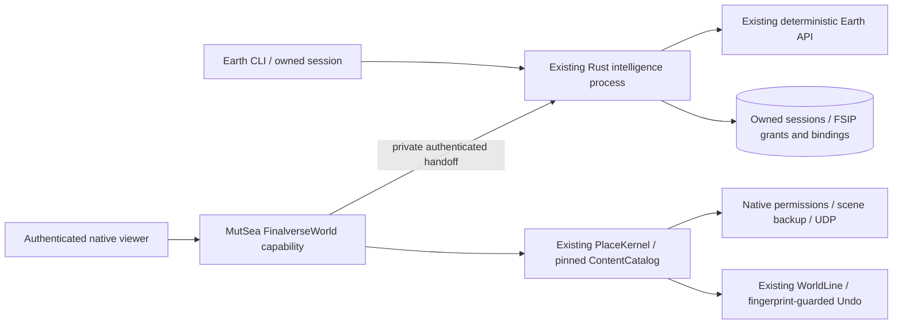

# v0.6 Earth–World Bridge: implementation record

Development baseline: Earth `a104a149`, MutSea `2b8602d6a1`, native viewer
`781ddb04cb`, Studio `d73be6a`. The v0.5 final CI runs passed all 12 jobs:
[Earth](https://github.com/finalverse/finalverse-earth/actions/runs/39416369460),
[Rust](https://github.com/finalverse/finalverse-earth/actions/runs/39416369508),
[inherited](https://github.com/finalverse/finalverse-earth/actions/runs/39416369489).

Existing viewer/MutSea worktrees are the integration checkouts. The older primary
viewer has extensive unrelated changes and is excluded from this work. Original
content, avatar identities and public deployments are preserved. All new world
acceptance uses an isolated local PostgreSQL-backed simulator. No public push,
deployment or v0.7 promotion is implied by a successful local check.

## Authority and reuse

The Rust runtime hosts the narrow bridge. No additional daemon or direct MutSea
database access is introduced. `Finalverse/World/ComposerBridge.cs`, `PlaceKernel`
and `ContentCatalog` already validate pinned assets, per-part native permissions,
terrain/clearance and budgets. FSIP uses those authorities. An Earth grant never
becomes unrestricted scene-edit permission.

The existing `experience` World operation is service discovery; bridge commands
use a separate `earth_bridge` namespace. The renderer and native object streaming
remain unchanged. The existing AI approval panel can review a prepared place,
but all commits of bridge-originated plans must pass the bridge's additional
grant check, including calls through the generic commit operation.

## FSIP scope

FSIP 0.1 describes sessions, contexts, artifacts, intents, plans, grants,
executions, receipts, bindings and presence. JSON Schema and TypeScript/Rust
bindings are versioned together. HTTPS/SSE are application transports; local
development uses loopback HTTP and private authenticated IPC. FSIP does not
replace the viewer protocol, asset formats or existing session events.

An experience manifest separates source records/provenance from generated
exhibition geometry and model interpretation. Asset geometry retains its original
license. WRI records retain CC BY 4.0 attribution; a CC0 geometry recipe must never
relicense those records. Source bindings live beside native transactions and do
not require changing fingerprinted asset geometry after creation.

## Identity handoff

An owner explicitly creates a short-lived, audience-bound handoff for one
experience. Only the authenticated MutSea capability supplies avatar and active
session identity. The configured bridge authority authenticates independently;
the one-use code is redeemed atomically and bound to those actual identities.
Matching names never prove ownership. Codes and reusable credentials do not
appear in public URLs, model context, logs or Git.

Commit requires current native session/parcel permission, matching reviewed
manifest and an unexpired, unrevoked grant. Interrupted world writes are reconciled
against native WorldLine/object state; they are never automatically replayed.
Expiry or revocation prevents new writes. Guarded owner Undo remains subject to
the authoritative native transaction fingerprint and creator identity.

## Coordinate boundary

WGS84/ECEF/local ENU computation remains in the deterministic Earth engine.
Projected contexts declare their CRS and transform. Region coordinates include
the actual region UUID. Pure virtual scenes carry no implied Earth location.

The Montréal pavilion is a **schematic exhibition**, not a geospatial reconstruction:
source facility positions and distances remain inspectable, while index-to-gallery
placement is explicitly artistic. This prevents a decorative scene from claiming
to reproduce real facility geometry, historical conditions or physical scale.

## Gate policy

Every G01–G20 result is recorded in `acceptance.md` as PASS, FAIL or NOT TESTED.
API success alone does not pass scene, viewer, restart, observer or Undo gates.
v0.7 starts only after the v0.6 integration and security gates pass. Hosted Lumi
must retain its one existing identity/runtime; no duplicate is started for a new
region. Public deployments require separate authorization after a reviewable
result exists.

## Integration source milestones

The tested local bridge spans viewer `ce2553ed0b`, MutSea `007f6a3295`, citizen
runtime `4a2f9d1`, and AI gateway `97fa085`. Source publication to GitHub main
was authorized on 2026-10-21. The subsequent compact workspace/conversation UI
is a separate viewer milestone. Source publication does not enable the hosted
bridge, change the public site, pass G16/G17, or promote v0.7.
