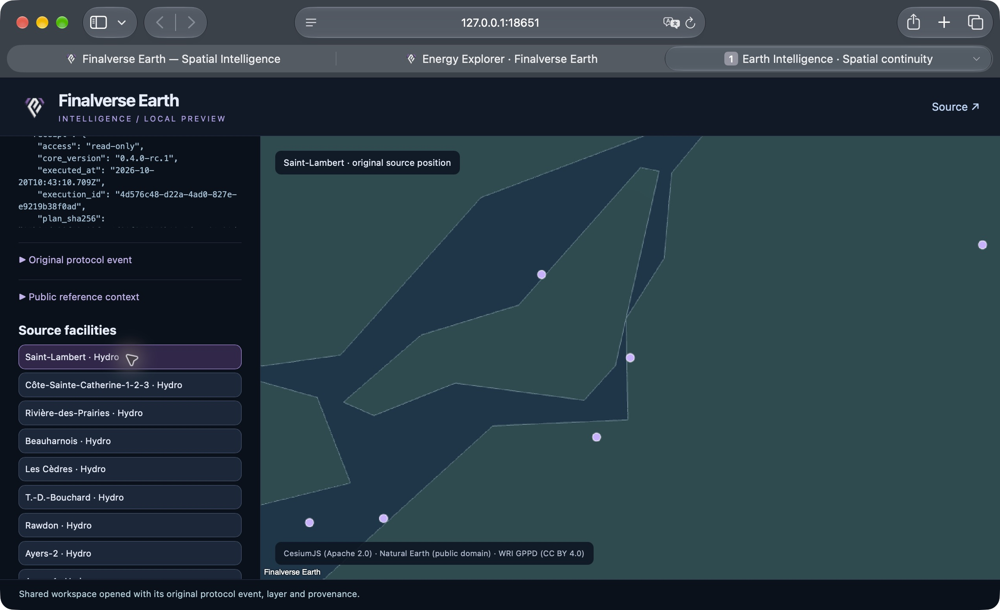

# Earth Intelligence v0.5 acceptance and performance

Recorded 2026-10-20 on Apple M1 / 8 cores / 16 GiB, macOS, Rust 1.92 and Node
24.22.0. Status: **local developer foundation demonstrated**, not a production
hosted service or a public v0.5 release. Installed local models and a separate
unprivileged PostgreSQL session database were used. The existing public v0.3
deployment remains unchanged.

## Five observed scenarios

| Scenario | Observed outcome |
|---|---|
| General AI | Native `earth ask` streamed actual `llama3.2:3b` chunks, persisted ordered events and usage. After daemon restart, resuming the same session correctly recalled the earlier event-log question. |
| Spatial intelligence | Local model proposed an exact typed renewable-facility plan within 100 km of source Montréal (`ne-place-1173`). Explicit approval executed through the existing Node authority, checked the exact source plan SHA and persisted source/runtime receipts. A separate hydro/solar comparison returned **18 facilities / 12 geographic groups**. |
| Browser continuity | The CLI's explicitly shared spatial snapshot opened in the in-app browser and native Safari. Source positions, saved camera, facility selection, WRI attribution, receipt and original sequence-9 `workspace.updated` event were observed. Safari downloaded the portable JSON; the existing v0.4 SDK/application restore accepted the actual Rust export with the same 18 features, camera and execution ID. |
| Coding | In a disposable external project, `qwen2.5-coder:3b` proposed changing subtraction to addition. No write occurred at proposal. The reviewed hash-bound patch was applied; separately approved Node tests passed under the OS network guard. A real local-model explanation of the explicit test receipt streamed successfully, without another patch or execution. |
| Security | Actual native CLI outside-root read returned nonzero/HTTP 409. Unit and HTTP integration also rejected traversal, symlink escapes, cross-owner access, unknown shell tools, changed approval hashes and approval replay. No external file was changed. |

The initial broad-context spatial experiment proposed a wrong city ID. It was
**rejected/revoked and never executed**. The fix queries the complete Canadian
place set and binds the model schema to source-derived city, radius and fuel
constraints. The regression rejects wrong or ambiguous cities, including
attempting to reuse Montréal for a new question about Paris. This was a measured
grounding defect, not hidden by describing the generated plan as successful.

Nonsecret evidence references for the observed runs:

- General session: `f0ef3269-eee8-47c0-87fa-451651bc14e6`.
- Hydro/solar source execution: `4d576c48-d22a-4ad0-827e-e9219b38f0ad`,
  plan SHA `05b24d438f53a93f1e4d80f958878b09e5d1ac64c20d2fb5381c4e6c406a6cf8`.
- All-renewable source execution: `f4b4fe80-33b9-4962-9983-c4bc4bd3c870`,
  plan SHA `90d60100db2e1767896565b86a07eac2d8482174cfe13286f9fa9535b052d624`.
- Coding session: `67a3daed-e3df-4138-90b6-8a7f57af46fc`; approved test
  receipt `a51142f0-59d2-4e1b-a231-2fa94c3ce550`, exit 0.

Private session exports, configuration, DB URLs and share keys are intentionally
not committed. Reproduce the scenarios with the [developer guide](developer-guide.md).

## Automated verification

- Rust: seven unit tests and four provider-transport tests; `cargo fmt --check`
  and all-target Clippy with warnings denied.
- Separate disposable PostgreSQL integration case: atomic request idempotency,
  actual native CLI/SSE, durable replay and conversation reconstruction, ownership,
  proposal/review/write separation, approval consumption, restricted tests,
  explicit test-receipt explanation, cancellation/revocation, restart recovery
  without replay, retention pruning and artifact-only share revocation.
- Browser view-model regression: exports a separate copy with current selection
  and camera while preserving source evidence and leaving the shared snapshot unchanged.
- Separate actual OS sandbox case: outside file access, writes, process creation
  and network denied; output overflow and cancellation terminate the child promptly.
  Local macOS execution passed. CI runs this case on macOS and Linux x64/ARM64;
  database integration runs on Linux x64. Consult the linked workflow results
  for their current outcome rather than inferring platform coverage from a build.
- Existing Earth: **43 core/PostGIS tests, 24 SDK/platform tests, five independent
  application tests** passed. Pinned globe verification/build, application build,
  import boundaries and adopted source formatting passed.
- The existing upstream-consolidated baseline passed 8,223 inherited tests, with
  one Windows-only skip on this Mac. The inherited CI remains enabled for main.

Deterministic CI provider/scene fixtures are explicitly synthetic. They test
protocol/executor behavior; the local observations above test real installed
models and real source data. No paid inference or external production load test
is required by CI.

## Bounded development measurements

These are individual local observations, not a latency SLA, inference benchmark
comparison or evidence of public multi-tenant capacity. Inference elapsed times
come from the verified adapter; first durable delta includes event persistence.

| Observation | Result |
|---|---|
| General answer, llama3.2:3b | 71 input / 44 output tokens, 3,322 ms total; first durable delta about 554 ms |
| Grounded hydro/solar plan, llama3.2:3b | 342 input / 81 output tokens, 7,939 ms |
| All-renewable plan, llama3.2:3b | 338 input / 86 output tokens, 8,848 ms |
| Patch proposal, qwen2.5-coder:3b | 184 input / 115 output tokens, 8,907 ms |
| Approved read-only spatial execution | 29 ms runtime wrapper for the all-renewable query, separate from inference |
| Approved Node test | 293 ms wrapper, exit 0, with clean environment and macOS network/fork denial |
| Test-receipt explanation, llama3.2:3b | 413 input / 36 output tokens, 3,574 ms |

`node earth/intelligence/benchmark.mjs` makes only 40 bounded local read-only
requests. One recorded sample:

| Endpoint/sample | Concurrency / count | Median | Observed p95 |
|---|---|---|---|
| Health | 1 / 10 | 1.18 ms | 29.15 ms |
| Owned session list | 1 / 10 | 3.36 ms | 6.21 ms |
| Owned session list | 4 / 20 | 3.48 ms | 5.38 ms |

Small-sample p95 includes cold connection effects. Measurements do not include
remote network, large histories, long model contexts or multiple simultaneous
models. A point-in-time `ps` reading showed approximately 5.1 MiB runtime RSS
after an idle period; this is **not peak memory** and excludes PostgreSQL, Node,
Ollama and model weights. Broader soak/peak/device work remains a v0.6 gate.

The initial output-overflow subprocess check waited for the 15-second deadline.
The executor now signals overflow as soon as a stream exceeds 64 KiB and kills
the active process group; the combined actual OS boundary/output/cancel case
completed in 0.23 seconds on the final local pass.

## Release boundary

Source is suitable for reviewed local development and further hardening. Do not
expose the runtime on the internet or advertise it as a hosted production coding
service. Stable identity/rotation, cross-device authentication, a full hostile-code
sandbox, independent security review, long-run quotas/backups, larger performance
samples and signed native distribution remain open. See [security](security.md)
and the [v0.6 roadmap](roadmap-v06.md).
