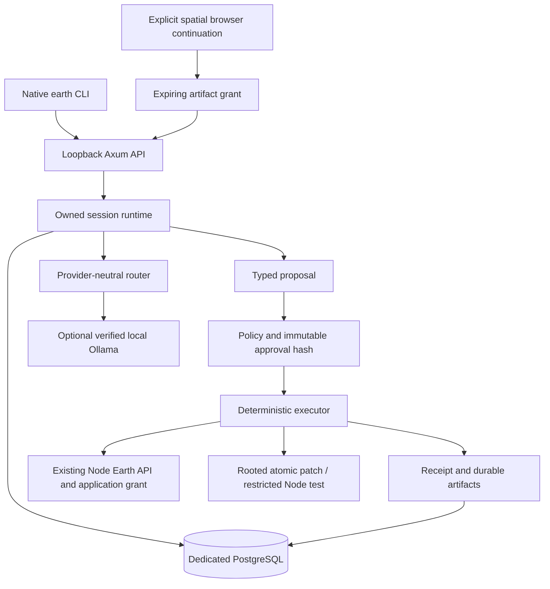

# Earth Intelligence v0.5 architecture and protocol

Status: local development preview. See [verified starting state](v05-baseline.md)
and [acceptance evidence](acceptance.md). The v0.4 Node SDK, existing application
sessions, world runtime and viewer remain independent.

## Code ownership

`earth/intelligence/src/` contains separate `protocol`, `store`, `model`,
`grounding`, `spatial`, `coding`, `sandbox`, `runtime`, `api`, `daemon` and `cli`
modules. `earthd` is one process, with five database connections, two active jobs
and four SSE streams. `earth` is a native HTTP/SSE client, not a wrapper around
Node or a web UI. The reviewed embedded browser app reads spatial artifacts only.

The Node addition `POST /v1/apps/{id}/query/validate` validates the exact plan
against the existing core schemas and the operator's installed application
grant. It does **not** execute a query. Rust never implements geographic math.
Execution uses the separate query endpoint and checks the returned plan,
read-only receipt and SHA-256 against the submitted canonical JSON plan.

`finalverse.intelligence` is a reviewed local grant for four public source
datasets and bounded read-only tools. Its manifest requests no filesystem,
world mutation or inference privilege. The authenticated Rust runtime owns its
own inference and coding policy; clients cannot grant themselves capabilities.

## Protocol 1.0

Serde types in `src/protocol.rs` are the wire authority. Unknown fields are
refused in requests/tool arguments. Messages carry a UUID request key, text,
optional selected model and explicit code file **or** same-session test artifact.
Session modes are `chat`, `spatial` and `code`.

Every event has `protocol_version`, `session_id`, monotonically increasing
`sequence`, `request_id`, UTC `timestamp`, typed `type` and typed `data`.

| Event | Meaning |
|---|---|
| `session.started` | Durable owned session created |
| `message.started` | Input, selected model and local privacy policy |
| `message.delta` | Actual streamed narrative chunk |
| `message.completed` | Provider-reported usage; generated narrative is not evidence |
| `tool.proposed` | Immutable proposal ID, type and SHA-256 |
| `tool.approval_required` | Proposal available for explicit review |
| `tool.started` | One-use approval consumed before execution |
| `tool.completed` | Artifact ID and execution receipt |
| `tool.failed` | Safe failure category or interrupted/unknown outcome |
| `artifact.created` | Durable result, patch/test receipt or spatial snapshot |
| `workspace.updated` | Original spatial artifact reference and source receipt |
| `session.completed` | Current operation completed; session remains resumable |
| `session.cancelled` | Inference cancelled or pending approval revoked |

Event append locks the session row and commits the event and cursor together.
POST messages/proposals are idempotent by `(session_id, request_id)` and input
hash. Same input returns its existing status; changed input with the same key
is rejected. A second process cannot own the dedicated DB's daemon lease.

`GET /v1/sessions/{id}/events?after=N` returns up to 256 ordered events. With
`Accept: text/event-stream`, the same events arrive as `earth.event` frames with
SSE `id` equal to the sequence. CLI reconnects at its last cursor, checks
contiguity and never automatically repeats a POST. Use explicit `after`, not an
assumed `Last-Event-ID` header contract. Disconnecting a stream does not cancel
the durable operation; POST `cancel` or press Ctrl-C in the CLI.

One session can have one active operation or pending approval. Approvals bind
the exact stored tool JSON, expire after ten minutes and cannot be reused.
Pending cancellation revokes them atomically. Restart marks executing proposals
`unknown` and running requests `interrupted`, emits a recovery event and never
replays a tool. Inspect the file or receipt before proposing another operation.

## Storage, privacy and observability

The idempotent migration creates only `earth_intelligence` in a dedicated local
`earth_intelligence_*` database. Runtime login has DML/schema usage, no schema
ownership, superuser, role creation, DB creation or RLS bypass. Ownership is
checked in every session/artifact query using the configured token hash.

Defaults: seven-day retention; operator range 1–30 days. Pruning runs at startup
and hourly, excludes running sessions and cascades events/proposals/artifacts.
Expired share grants are pruned. Per owner: 128 sessions. Per session: 4,096
events, 8 MiB event bytes, 32 artifacts; streaming reserves terminal audit space
and new requests are refused before exhaustion; each artifact <1.9 MB. Exports are private
files, never silent uploads. Database backups/host disk encryption remain operator
responsibilities. History context is reconstructed from persisted events with a
16 KiB bound, including after a process restart.

`tracing` emits structured JSON HTTP spans with generated/request correlation
ID, method, matched route, status and elapsed time. It does not log credentials,
query strings, request bodies, prompts or model output. These spans can feed an
OpenTelemetry subscriber; an OTLP exporter and distributed trace backend are
not configured in v0.5. Domain events retain operation correlations and receipts.

## Providers and grounding

The provider trait exposes discovery and cancellable streaming with typed
usage. The router matches required stream or structured-JSON capability,
explicit/default model, installed availability, zero provider fee and local-only
privacy. Metadata/discovery have three-second deadlines. There is no cloud
fallback, POST retry, model download or mandatory provider.

Only Ollama has been implemented and verified. `/api/tags` excludes cloud/remote
descriptors; `/api/show` rechecks locality and completion support **before** any
private prompt is sent. Ollama structured JSON-schema generation is an adapter
capability, not a claim that all models share native tool-call semantics. Native
tool calls are refused. NDJSON is parsed incrementally with bounded backpressure;
inference has a 90-second total and 20-second idle deadline, bounded lines/output
and required clean `done`. Token counts/latency are provider observations.
Selection is explicit and availability-bound; adaptive latency ranking is deferred.

Source grounding constrains model proposals to actual Canadian place IDs,
explicit radius/fuels and visible defaults (100 km radius, 10 km group edge,
100 results). Unknown/ambiguous places fail closed; a follow-up can reuse an
approved location only with a narrow recognized vocabulary. A complete Canadian
source query avoids silently taking the first 100 global places. Model output
is validated again against those constraints, then by Node, before approval.
Temporal plans use the archived Ridgecrest dataset and two explicit UTC dates
or timestamps. Other arbitrary natural-language GIS tasks are not supported.

## Browser boundary

CLI `workspace share` creates a one-hour, revocable capability for **one committed
spatial artifact**. The key is written to a private file, absent from URLs/logs/
localStorage and cleared from the password input after use. Browser routes expose
only that snapshot, its original `workspace.updated` event and public reference
context; they cannot read private messages, source files or other sessions.

The local globe restores source positions and camera, permits selection and
exports a separate v0.4-compatible Energy Explorer copy with current selection
and camera without rerunning the original
analysis. The public Canada outline is a separate bounded reference query with
its own attribution/receipt. No ion assets or paid basemap are used. Engine and
data attribution remain visible. Full cross-device identity/sync is deferred;
this is authenticated local continuity, not an internet sharing service.
