# v0.4 intelligence and independent application

The v0.4A foundation commit `cfad05d` passed all four Earth CI jobs before v0.4B began. The independent Energy Explorer consumes the actual SDK tarball. Core deterministic computation stays in the existing transport-neutral JavaScript engine, using GeographicLib/PostGIS; no measured requirement justified a duplicate Rust engine.

```mermaid
flowchart LR
  User --> App[Independent Energy Explorer]
  App --> SDK["@finalverse/earth"]
  SDK --> Scope[Server-owned application grant]
  Scope --> Router[Local planner router]
  Router --> Ollama[Ollama adapter]
  Ollama --> Intent[Bounded typed intent]
  Intent --> Validate[Core schema + grant validation]
  Validate --> Review[Human plan review]
  Review --> Execute[Deterministic spatial executor]
  Execute --> Receipt[Result + provenance + receipt]
  Receipt --> Map[Map / selectable conversation artifact]
  Map --> Workspace[Explicit local save / export]
```

## Reuse and boundaries

Existing Earth local inference, source catalogs, registry permissions, shared schema helpers, PostGIS proximity, geographic distance, receipts and v0.3 workspace contracts are reused. The Finalverse AI Gateway's provider abstraction, bounded context, correlation and usage conventions and Hermon's OpenAI/Ollama message shapes were inspected. Earth remains independent: it neither imports a world executor nor requires those services. No additional agent framework, paid provider or Rust microservice was introduced.

`PlannerRouter` accepts operator-configured adapters with `describe`, `discover` and `propose`. The adapter exposes model identity, local availability, spatial-plan capability, latency estimate, provider fee, cancellation/deadline and token usage. Selection considers operator preference, task capability, availability, local-only privacy, zero provider fee and configured latency estimate. Estimates are declared configuration, not benchmark-based model ranking. Only the local Ollama adapter is implemented. The contract permits other adapters later; it does not claim working cloud providers.

Structured JSON inference is **not streamed**. Discovery and proposal responses report `streaming:false`. The shared event contract supports incremental `message.delta` for future clients; current user/system messages and complete artifacts do not masquerade as streamed model tokens. No SSE service, resumable provider stream or cross-device session server is claimed.

Only server-selected loopback Ollama is reachable. Browser requests cannot choose endpoint, model, provider credential or system prompt. Model discovery excludes cloud-tagged/remote entries. A public-origin server refuses a configured planner entirely in this preview; local AI remains opt-in, bounded to two concurrent planning requests and 20 seconds per model request. Provider discovery has a separate 3-second deadline. Planning supplies only the bounded canonical prior plan, resolved source place name and selected public record identity. Unknown context fields or ungranted datasets fail before inference. The model returns an intent; deterministic translation resolves the actual catalog place ID. Named fuel filters must survive translation or the proposal is rejected. The narrow follow-up grammar “only/just [source fuel]” reuses an already approved canonical energy place/radius and operation; it cannot fill a new requested radius, change location or run a query. This deterministic normalization fixes the small local model's tendency to drop the previous radius. General follow-ups remain model proposals and can fail.

The server validates the proposed typed plan against the actual tool schema and grant **without executing it**. Human review is an application UX gate; read-only queries remain callable within the approved server budget. It is not a cryptographic authorization ceremony. Persistent local save requires an explicit UI action; no model writes workspaces, SQL, files, networks or world state.

## Shared SDK session protocol, version 1

`IntelligenceSession` is browser/Node compatible, renderer-free and in-memory. It has UUID session/event/request IDs, monotonically increasing sequence numbers and UTC timestamps. Event payloads are strict TypeScript discriminated unions:

| Event                 | Meaning                                                |
| --------------------- | ------------------------------------------------------ |
| `session.started`     | New local session, protocol version 1                  |
| `message.delta`       | Bounded user/system text; explicitly non-authoritative |
| `plan.proposed`       | Validated proposal, provider metadata and proposal ID  |
| `approval.requested`  | Explicit approval is needed for this pending proposal  |
| `tool.requested`      | Exact reviewed/manual deterministic query              |
| `tool.completed`      | Authoritative server response, query and receipt       |
| `artifact.created`    | Interactive result references the same server response |
| `execution.completed` | Artifact ID and execution receipt                      |
| `session.failed`      | Typed failure/cancellation with request correlation    |
| `session.completed`   | Local session closed                                   |

`propose` cannot execute. `approve(id)` consumes a pending ID exactly once, then sends the same plan through server validation. A new proposal supersedes the previous pending proposal. `run(plan)` is for an explicit deterministic UI action. Single in-flight operation per session; cancellation aborts Fetch and clears pending approvals. A failed or cancelled execution has no automatic replay/retry. A read-only server calculation already started may finish despite a disconnected browser.

`replay(afterSequence)` returns cloned events without running tools. The ring retains at most 128 events and about 4 MiB of encoded JSON (actual object memory differs); older cursors return `reset_required:true` so a client cannot mistake a partial log for complete history. Out-of-range cursors fail. A new browser/process creates a new session ID; a saved workspace is a document, not an approval or a live session. Conversation is not automatically persisted; authoritative results are separately saved by explicit action. This is a safe local reconnect/read-back contract, not a distributed durable event bus.

## Application methods

`cluster_features` first uses the existing authorized within-distance selection, rejects truncation, then calculates at most 4,950 WGS84 inverse distances over 100 points. Deterministic sorted connected components and fuel groups accompany the existing measurements, source version, provenance and receipt. Cross-backend membership/grouping parity is tested. No planar approximation, machine-learning density claim or physical transmission-grid inference is involved.

The SDK and scoped OpenAPI expose the actual 26 tools, optional planning context, provider discovery, typed query receipts and local session contracts. The existing v0.3 API paths and workspace format remain compatible. New core receipts identify `0.4.0-dev.1`; the deployed v0.3 service is unchanged.

## Workspace and security review

Application localStorage is namespaced, but same-origin JavaScript can inspect browser storage. Only reviewed trusted same-origin apps are supported. App IDs are scope selectors, not authenticated principals. Public data remains available through the global anonymous API; manifests do not make public datasets private. The development server loads operator-owned grants outside the web root and never accepts installations over HTTP.

Imported files are capped, validated, copied on duplicate IDs and rejected for invalid point geometry/plan-receipt mismatch. No imported query runs on open. Saved results and their hashes/receipts are editable local content, not signed proofs; the UI says so. Credentials are forbidden in app state, but users can type private information into titles/notes: review exports before sharing. There is no multi-tenant identity, private workspace server or arbitrary remote plugin sandbox.

## Next boundary

Release review comes before public hosting or package publication. Authentication, private datasets/workspaces, structured streamed inference, distributed sessions, CLI, React hooks and a shared Cesium package remain future work. The application-specific Cesium adapter proves separation without prematurely generalizing it. Finalverse Viewer/MutSea/world mutation are unchanged.
