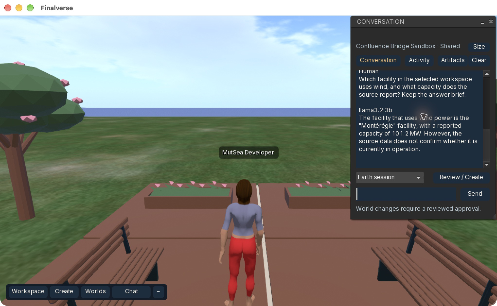
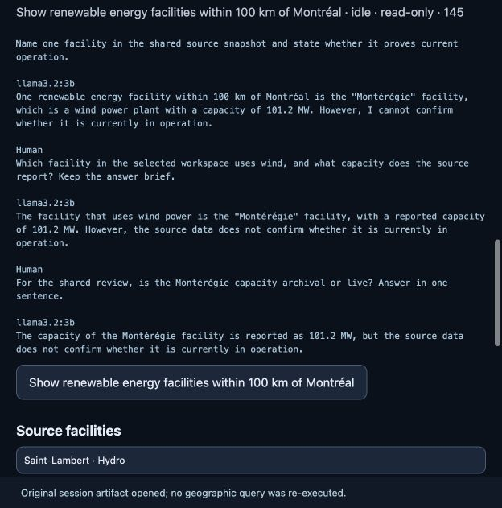
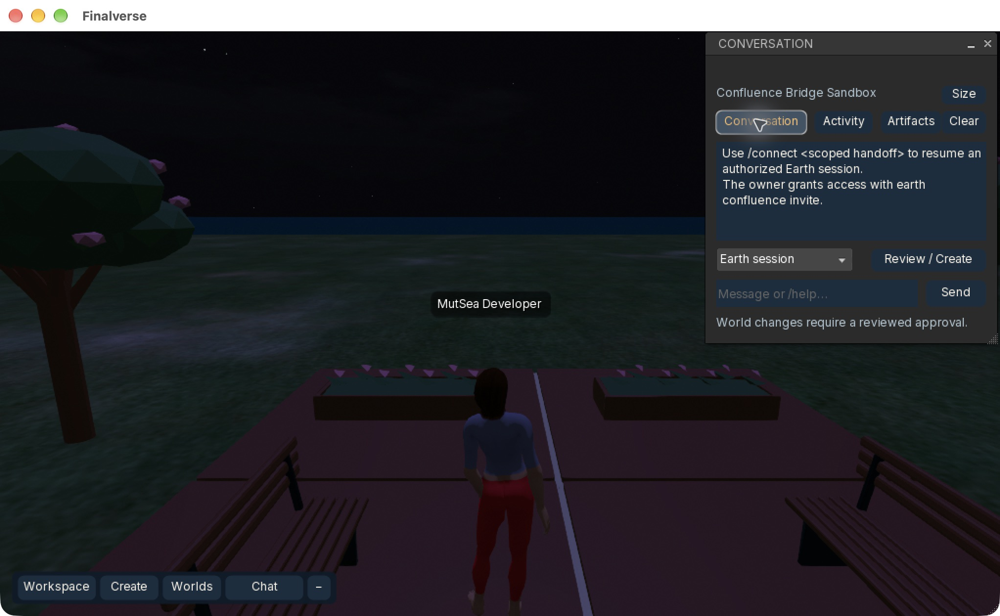

# v0.7 acceptance · in progress

This is a local R&D integration slice, not a completed v0.7 milestone. All 20
release gates must be assessed before a public v0.7 package is recommended.

| Gate | Status | Evidence / boundary |
|---|---|---|
| G01 v0.6 baseline | PASS | Intended source changes published; Earth CI green; Mac build, 119 tests, native approved creation/Undo and cross-region material delivery verified. Hosted Lumi/Harbor upgrade acceptance remains separately NOT TESTED. |
| G02 Viewer builds | PASS | macOS arm64 native build, including shared-session replay UI. |
| G03 Existing tests | PASS | 119 native CTest targets; Rust existing session/approval/coding/PostgreSQL regressions. |
| G04 Conversation streaming | PASS | Real local llama3.2:3b answer arrived through canonical persisted deltas, the native capability relay and the browser replay. Source-grounded 101.2 MW answer visible in native evidence below. |
| G05 Activity feed | PASS | Actual native region/system activity and canonical session events observed. Category/severity filters remain to implement. |
| G06 Spatial artifacts | PASS | Versioned geographic reference and original source preview opened in native Artifacts; browser opened the full 24-facility original workspace without running another geographic query. Other artifact producers remain unimplemented. |
| G07 Earth in Confluence | PASS | Native source preview, grounded question and existing Earth–World exhibition path work in the isolated Confluence region. An immersive geographic display/editor is not claimed. |
| G08 Existing Lumi | NOT TESTED | Existing identity/controller path preserved; no duplicate Lumi created. Shared-session participation remains open. |
| G09 Unauthorized access | PASS | Real PostgreSQL and private HTTP middleware: wrong actor/login, code/file/provider/foreign-artifact access rejected. |
| G10 Multiuser sharing | PASS | Two independent native identities present together. Read-only observer replayed 145 canonical events, saw the other avatar's new question and the same artifact; its proposal attempt was rejected. Presence granted no editing authority. |
| G11 Revocation | PASS | PostgreSQL/native API reject revoked/expired grants. Actual browser revocation cleared conversation, source facilities, globe entities and export capability. The final native build also cleared its shared source/transcript and requested an explicit new connection after owner revocation. |
| G12 Approval required | PASS | Shared read/propose grants have no approval or world-edit capability; inherited native approval path unchanged. |
| G13 WorldLine receipt | PASS | New source-backed 94-part exhibition committed through existing native approval; receipt sync recorded, native inspect returned the committed receipt. This does not yet include Lumi's shared-session layout proposal. |
| G14 Undo | PASS | Authorized native Undo recorded; independent UDP object observation confirmed 0 of the 94 receipt-bound objects remained. |
| G15 Continuity | PASS | CLI-created source session → Web → native Viewer question → Web replay. Session ID, artifact ID/version and content hash remained identical. Scoped CLI replay required no owner configuration or token. |
| G16 Restart recovery | PASS | Actual owned runtime restart recovered the same browser conversation and source; reopened PostgreSQL store regression passed. A new native login requires a fresh explicit handoff. |
| G17 UI layout | PASS | Native compact/expanded heights, source inspection, usable composer, cleared accepted input, minimize/restore and main-thread updates verified. Final-build renewed handoff replay and revocation clearing passed. Broader accessibility/display-scale coverage remains open. |
| G18 Performance | NOT TESTED | Ten warm loopback replay requests: 13.88 ms min / 14.44 ms median / 54.54 ms max, 1,619-byte idle response. Eight concurrent readers passed the isolated PostgreSQL regression. No complete controlled native/frame/startup comparison or performance gain is claimed. |
| G19 Existing world preserved | PASS | Persistent two-region fixture retained; existing garden remained visible after module upgrade and native relogin. Observer saw 172 objects during exhibition (78 baseline + 94), then a fresh native observer confirmed the original 78 remained after Undo. Public deployments and databases untouched; prior container retained for rollback. |
| G20 CI | PASS | Earth implementation commit 56a2bcdb passed all three PR workflows: Intelligence, Independent Earth Core and inherited CI/browser gates. Native Viewer/.NET verification is local; a complete hosted native multi-platform build matrix is not claimed. |

The fixed v0.6 checkpoint was pushed to Viewer main as `f5538e778e` and Earth
main as `8e1e8c64`. The public packaged preview remains its separately documented
older release. There has been no silent public deployment or new release claim.

## Combined acceptance, 2026-10-22

The canonical source session was `1d8015bf-0c2e-4b73-953a-c5f346828252`.
Its geographic artifact stayed `54e98262-64a9-4dc5-a833-ed72a0448521`, version 1,
SHA-256 `acbb2491b5a0d4fe917dd86c801378faa81cd1898193e6eb63bbf393dfd74313`.
No credentials, native capability addresses or private fixture files are included.

The first exhibition preview correctly refused an obstructed site. A fresh
single-use handoff and explicit native movement to clear terrain succeeded;
there was no policy bypass or replay of an uncertain commit. The committed
WorldLine operation was `ac8cf5ed-0fac-47cb-b68a-5340625396a6`.

The macOS arm64 build passed, all 119 CTest targets passed, and the native
presentation target contains 20 tests. Rust clippy with warnings denied, existing
session/approval/coding regressions, real PostgreSQL sharing/revocation/restart
and private HTTP authentication tests passed. Eight Node FSIP/browser tests
include clearing an opened artifact when session access ends. CI status is
recorded after the integration branch run; local results do not substitute for it.

The final private viewer build was relaunched after a clean logout. A new
one-hour handoff recovered the same canonical session. During a one-minute
minimized observation, the native participant's server-side last-seen timestamp
remained unchanged, confirming that minimized replay polling stopped. Restoring
the panel resumed access checks; revoking that grant cleared the native shared
transcript and source display. The test viewer was then closed cleanly.

Source integration commits:

- Earth: `56a2bcdb9eb9ea87fbe392850c5cd7aed94cf52f`
- MutSea: `0314bbbfb8` (`codex/confluence-v07`)
- Viewer: `f405e06090` (`codex/confluence-v07`)

The [draft integration PR](https://github.com/finalverse/finalverse-earth/pull/1)
tracks acceptance and CI. The [initial Intelligence matrix](https://github.com/finalverse/finalverse-earth/actions/runs/39718299944)
passed on macOS, Linux x86-64 and Linux ARM64. Draft status preserves the open
Lumi and performance release gates; published source is not a release claim.

The same implementation passed the complete PR checks:
[Earth Intelligence](https://github.com/finalverse/finalverse-earth/actions/runs/39718531359),
[Independent Earth Core](https://github.com/finalverse/finalverse-earth/actions/runs/39718531257),
and [inherited CI including Street Level browser fixtures](https://github.com/finalverse/finalverse-earth/actions/runs/39718531248).
This evidence-only follow-up changes documentation and one screenshot, so it
does not rerun the already successful implementation matrix.

## Remaining work before v0.7 release

- Existing Lumi as an explicitly authorized contributor to this canonical session,
  including source inspection, bounded layout proposals and execution feedback.
- Activity category/severity filters; additional artifact producers and interaction
  surfaces beyond the geographic snapshot. Typed enum variants alone are not implementations.
- Full native performance comparison, cross-platform UI/accessibility checks and
  hosted acceptance. The local fixture does not prove cross-device production SSO.
- Review and completion of remaining gates before main consolidation or a public package.
