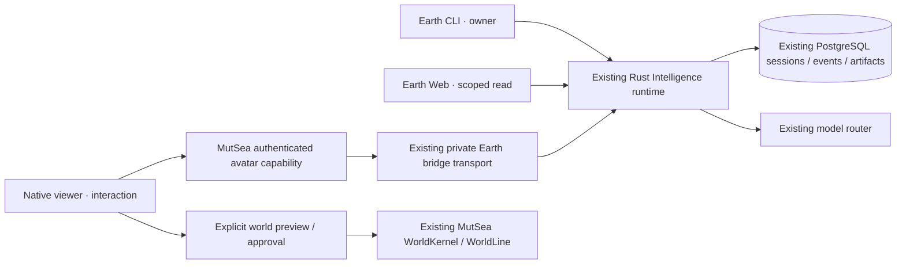

# Confluence v0.7 · local integration preview

This is the first working v0.7 integration slice, not the completed milestone or
a hosted release. The verified v0.6 source baseline is Earth `8e1e8c64`, Viewer
`f5538e778e`, MutSea `007f6a32`, Agent Runtime `4a2f9d1e`, Gateway `97fa0859`.
The public Earth deployment and existing hosted worlds are not upgraded here.

The new `confluence_grants` table holds access metadata only. No conversation,
model router, avatar identity or world executor is duplicated. A named avatar
receives explicit read or read/propose access to one non-code session. Its grid,
region and current native capability session are checked by the server.

Viewer and browser histories are bounded display projections. PostgreSQL remains
canonical. Their Clear controls do not delete durable messages or reset AI memory.
Existing World AI, hosted Lumi and nearby chat remain separate recipients with
existing authority. Hosted Lumi participation in this shared Earth session is
not yet verified; this preview never creates another Lumi.

The optional `wish-cli` was inspected read-only. Its TypeScript/Ink shell has its
own session ingress, provider integration and SDK dependencies. No Wish source,
credentials, filesystem tools or provider router were copied. Earth CLI already
provides the required session protocol. A future Wish adapter should consume the
scoped protocol rather than replace it or relay local coding history by default.

See [acceptance](acceptance.md) for the exact verification boundary and remaining
work. Experimental SpatialDB is not a dependency.
