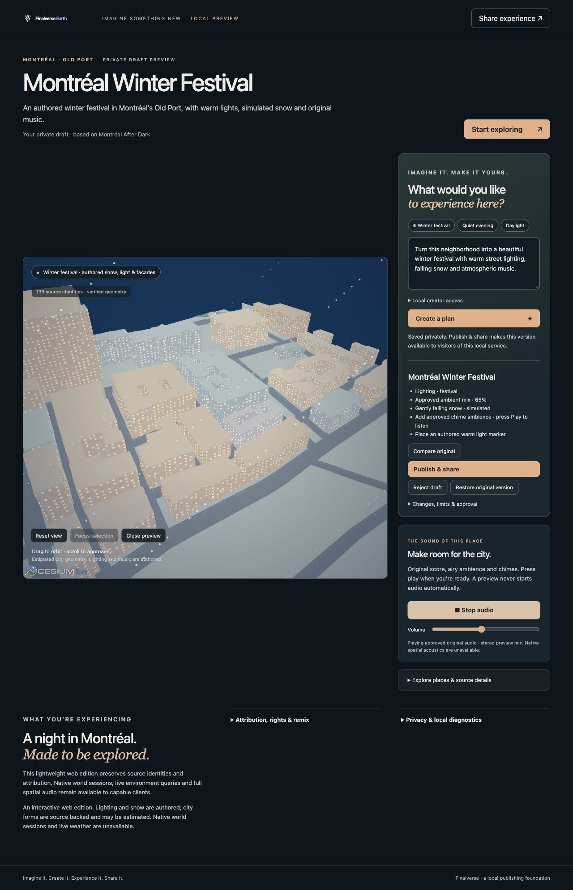

# Finalverse M4-B — AI Experience Creator

Accepted locally, 2026-10-29 (Asia/Shanghai). Describe → generate → validate → isolated preview → explicit approval → private save → publish → anonymous shared reopening is operational with the deterministic EI provider. No gate is blocked. A real model remains explicitly unverified.

## Exact baselines and delivery

| Repository | Accepted baseline | Implementation commit | Isolated branch |
| --- | --- | --- | --- |
| Core | `dea4a45683063db20a728a5b6e366c02c8b84c57` | `1c69d312cd2028329ac93e53356b0c1e7cfb3ba7` | `feat/m4b-ai-experience-creator` |
| Earth Web | `f550d6e3294250699cd585942c01d91fb33d5805` | `823b43a46a0311145ec4d51e1bf0296351549839` | `feat/m4b-web-creator` |

Worktrees: `/Users/wenyan/Finalverse/dev/worktrees/core-m4b-20261028` and `/Users/wenyan/Finalverse/dev/worktrees/earth-web-m4b-20261028`. Acceptance reports/evidence are committed separately from the implementation; the final delivery HEADs are reported in the chat.

M3-A was inspected and reused: Core `d476e2876e4329811227668f7ff5be83d109840e`, Infinity `e0bb10a9e2e48e470066990fe5a899a34f84f297`, and their acceptance reports. Accepted worktrees, primary repositories and the three M1-C deliveries remain clean at their previous commits (see `evidence/preserved-worktrees.json`). No accepted worktree was edited. No new repository, new chat, subagent, push, merge, public deployment, world service or next milestone was started.

Historical M0–M3-C/mobile/hardware acceptance was not rerun. Compatibility checks covered the changed public APIs, old omitted-field canonical bytes, existing package contracts and affected browser protocol validation only.

## Implemented APIs and contracts

The existing M3-A `ei::Provider`, `ec::creation::validate` and `ek::creation::History` remain the authoring pipeline. `History::from_version` accepts a host-trusted published root; it does not grant service authority. Existing EL, SIL and M2 package schemas stay in place. Absent new fields are omitted, preserving old content hashes; the original publication still resolves as `16f19110720a52c4a0a02567c2f070286b88e022de90a3ad66470287eb63ebea`.

The existing `finalverse.creation-proposal/v1` gains one bounded data operation: `atmosphere { effect: "snow" | null }`. `finalverse.authored-experience/v1` gains an optional atmosphere. Existing operations cover lighting, exposure, presentation, metadata, approved audio, two bounded authored light objects and host-whitelisted interactions. Source geometry, identities, permissions and asset rights cannot be edited. Unknown operations, duplicate keys, executable fields, changed asset rights and stale bases fail validation.

An optional `authored` field in `finalverse.publication-content/v1` contains the existing proposal and `ExperienceVersion`. Its hashes, resulting package and description are sealed into the publication. Publication independently replays EC against the available parent and requires the exact private history receipt written by approved EK execution. A valid but unsaved candidate cannot bypass approval through the general publisher route.

| Route | Behavior |
| --- | --- |
| `POST /api/v1/creator/generate` | Typed `{base: PublicationRef, intention, provider: "fixture" | "configured"}`; propose and deterministically validate; return bounded draft, exact proposal hash, original/candidate and unsupported capabilities. |
| `POST /api/v1/creator/{id}/preview` | Revalidate and enter preview. |
| `.../approve` | Exact proposal hash and prior preview required; EK stores one-use approval. |
| `.../save` | Consume approval, execute local authoring transaction, atomically save immutable owner-only history; no public publication. |
| `.../publish` | Exact saved version plus `confirm_public: true`; replay validation and saved receipt required; reuse registry, parent rights and CAS routes. |
| `.../revert` | Restore an existing immutable history version; published editions remain unchanged. |
| `.../cancel`, `.../reject` | Invalidate approval and remove the in-memory draft. |

All creator routes require the publisher role. Visitor and administrator credentials cannot generate. Actions are closed typed JSON with a 1 MiB ceiling. Drafts are bounded to 32, expire after 30 minutes of inactivity on the next operation, and disappear on service restart. Private history files remain available for host replay; this milestone does not add a saved-draft library UI.

## AI integration and authorization

The deterministic EI provider now recognizes winter/snow alongside festival/warm/quiet/daylight, generating the Winter Festival proposal without paid access. It uses the approved M2 chime/ambient/score and the existing CC0 M2 light specification. No asset license was invented.

The optional configured path reuses M3-A's structured EI request/proposal transport contract. Host environment `FINALVERSE_EI_ENDPOINT` may be loopback HTTP for a local model adapter or HTTPS for a remote adapter; embedded credentials, query strings, fragments, insecure non-loopback HTTP and redirects are refused. `FINALVERSE_EI_TOKEN`, if needed, stays on the host. Responses are bounded to 1 MiB/30 seconds and pass `StructuredProvider`, then EC. A raw commercial model API needs an adapter serving this existing typed contract. **No endpoint was configured, no model request was sent, and local/remote real inference is unverified.** The UI requires explicit selection before sending a prompt to a configured provider.

Publisher credentials stay in tab memory/password input, never in storage, proposal, saved history or links. Explicit approval is bound to the full proposal hash/current base; save consumes it. Public publication is a separate explicit action. Authoring grants only local creation/source-read/consented-audio permissions. This web slice supports no MutSea commands or world grants; those remain unsupported and unknown world operations are rejected. It does not simulate successful native world execution.

## Preview, visual presentation and flagship evidence

Earth Web's Cesium 1.138.0 player is extended. The original publication and loaded source models stay fixed while a separate draft document controls authored material tint, exposure, directional/ambient lighting, decorative window emission, a light marker, simulated snow and an approved audio mix. Comparison restores the original presentation without touching published bytes. Reject/cancel restores the original; version revert selects the original history version. All approved audio playback needs a separate user click, including on recipient reopening.

The UI offers natural-language entry, suggested ideas, validated change summary, preview/comparison, approval, private save and publish/share. It reveals relevant actions as the draft advances; attribution, source details, diagnostics and local access sit behind disclosure controls. Existing entity selection, focus, share dialog keyboard handling, reduced-motion behavior and privacy controls remain. Decorative windows and screen-space snow are explicitly authored, not surveyed detail or observed weather. Source GLBs are unchanged.

The Montréal Winter Festival walkthrough generated and validated snow/lighting/audio/light-marker modifications, compared before/after, activated four approved audio layers, approved the exact hash, saved privately, published, copied the versioned link, reverted, and closed. Correlated HTTP negative checks rejected unauthorized world fields, changed approval hashes, approval without preview, unapproved save, direct publication without an approval receipt, and publication without explicit consent. These negative payloads were checked through HTTP/Rust, not presented as an end-user arbitrary world-command editor.

Fresh recipient document: anonymous tab, 390×844, no creator credential or approval and zero audio sources until its own Play click; then four sources. Original source/creator/audio attribution, licenses and parent link were inspected. This is a new app session in the same browser profile, not an incognito/profile-isolation or physical mobile test. Desktop was 1280×900. Both loaded all 139 original entities. Browser console errors: zero in both final release tabs. The temporary viewport override and all owned tabs were reset/closed.

The published asset map is exactly the parent's: **143 assets / 6,660,068 bytes**, all downloaded and hash-checked for the authored edition. The verified scene CAS is unchanged, preserving all 139 source identities. No scene/asset upload, remote asset download or user-supplied executable content was introduced.

- Proposal: `7f33489810c3c3ba0dc5a3be0ddf633594bedb344021fe5669b932df52bfdc4d`
- Saved authored version: `06b045316eb88e75e876f9b11725afafe03763a75c5cc23dfaaa45bb6a1e9ab3`
- Publication version: `bf2d6e42a5c55518c1a06a143f419b2df21847492f6fd8fc7f4c1af8d1206d72`
- Share path: `/x/montreal-after-dark/bf2d6e42a5c55518c1a06a143f419b2df21847492f6fd8fc7f4c1af8d1206d72`

The share path requires an owned running local service. Acceptance services are now stopped; no public URL was created.

## Verified checks and actual performance

**23 targeted tests passed: 9 new Rust creator tests + 4 new authored browser-contract tests + 10 affected existing protocol checks.** No ignored tests. **18 real HTTP checks** passed, plus four checks after a real service-process restart (publication/entry persistence, a persisted asset hash, private history unservable). Formatting, strict Clippy on the five affected Core crates, offline optimized build, browser syntax checks and standalone player build passed. No whole-workspace/native acceptance suite was repeated. Raw logs and receipts are under `evidence/`; `scripts/check_m4b_evidence.py` cross-checks browser/HTTP hashes, dimensions, consent, rendering and cleanup.

Environment: macOS 27.0.1, Rust 1.99.1, Node 22.18.0, Cesium 1.138.0, IAB Chromium 156. These are observed warm local runs, not cold-network benchmarks or aggregate usage evidence. Previous candidate-run timings/screenshots were superseded by the final release receipts.

| Measurement | Final browser run |
| --- | ---: |
| Original controls usable, from navigation | 305 ms |
| Original first / all 139 geometry ready | 372 / 1148 ms |
| Proposal generation + validation | 30.4 ms |
| Preview activation + next animation frame | 45.0 ms |
| Private save | 20.8 ms |
| Publish response | 42.5 ms |
| Fresh shared mobile-width controls usable | 185 ms |
| Shared first / all 139 geometry ready | 249 / 798 ms |
| Winter desktop rAF intervals: mean / p95 | 16.68 / 18.30 ms |
| Winter mobile-width rAF intervals: mean / p95 | 16.67 / 18.50 ms |

Frame measurements use 180 `requestAnimationFrame` intervals, approximately 60 callbacks/s. They are browser responsiveness samples, **not GPU draw timings** or a physical-device performance claim. The independent HTTP run measured generation 39.5 ms, private save 16.0 ms and publication 84.0 ms; its first publication creates durable files, while the later browser publication is idempotent.

Both final cleanup receipts show zero models, shaders, object URLs, audio contexts/sources, animation frames and in-flight assets; viewer inactive, no active draft, no snow/markers. Private histories and immutable publications survived process restart; approvals did not become recipient consent. All owned ports are closed. Source records, registries, credentials and evidence are retained privately for reproduction.

Disk capacity was monitored: approximately 10 GiB initially, 9.2 GiB during dependency compilation, 11 GiB after the optimized build, and 9.6 GiB near completion. Compatible target artifacts and Earth dependencies were reused. No cache/source/Git/evidence/worktree deletion was necessary. The browser bundle has 400 files; source/binary/bundle hashes are recorded. Generated-token scans and the local remote-credential guard passed.

## Limits and next milestone

Verified: the complete local deterministic creation-to-sharing gate, source/asset provenance, permission/hash enforcement, preview isolation/comparison, versioning, private save, publishing, anonymous reopening, responsive widths and cleanup. No acceptance gate is blocked.

Implemented but unverified live: the host-configured real-model transport. Deferred: physical/native mobile Creator, other browser engines, forced WebGL/device-loss recovery, multi-user creator identity, remote/cloud continuity, saved-draft library UI, public hosting, arbitrary assets, outdoor performance-stage assets, richer interactive behaviors, collaboration/discovery and unrestricted remixing. Private histories persist locally; cancellation drops active memory state without deleting saved/published history. Aborted model requests may take up to the host transport timeout; abandoned draft entries expire lazily or at shutdown.

The web edition uses simplified authored lights/markers and screen-space particles, not native Infinity lighting/physics or MutSea authorization. New atmospheric features require capable clients; older clients may reject new authored fields while continuing to read old unchanged records. Source estimated geometry is never promoted to surveyed detail.

Recommended next: **M4-C visual quality and configured-model evaluation**, with richer licensed reference assets, camera/material/atmosphere refinement, and measured user feedback. M4-D one-click remix remains a subsequent product milestone. Neither was started.

