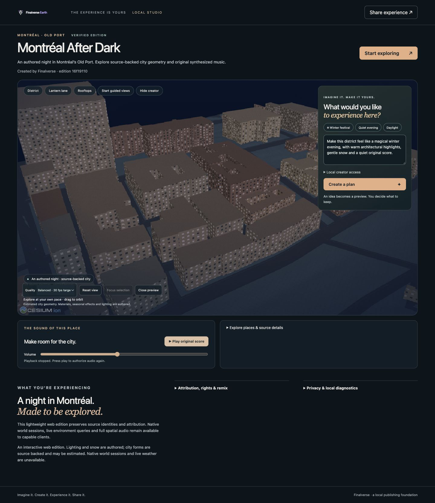
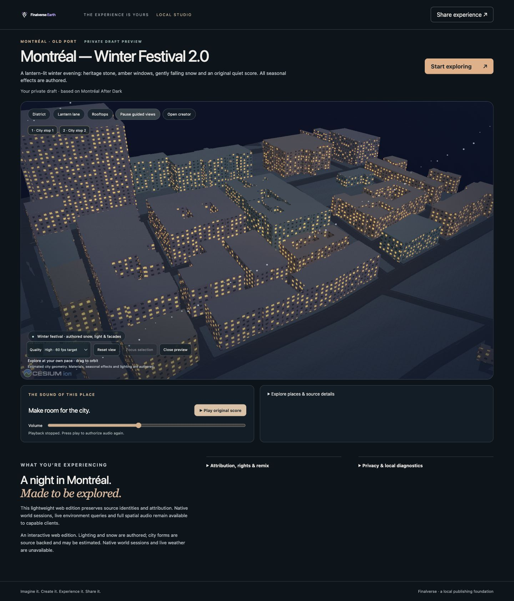
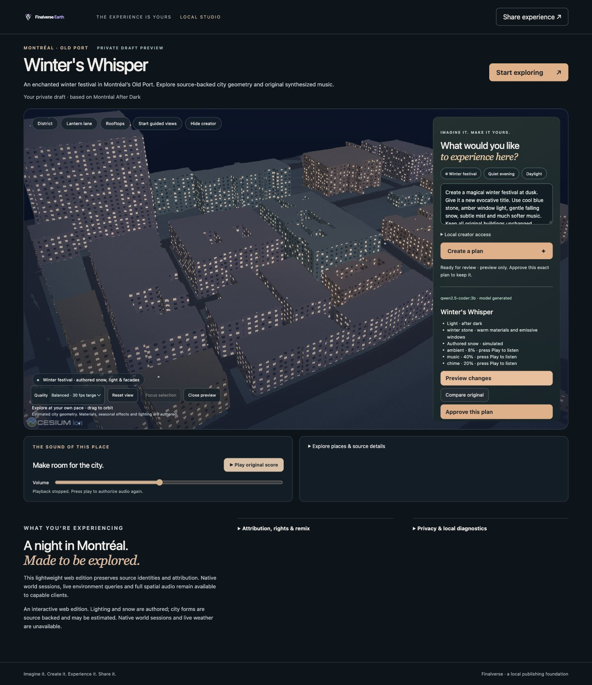
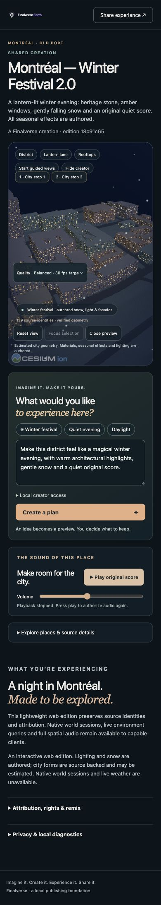

# M4-C acceptance — local delivery

Date: 2026-10-29. M4-C is implemented and verified within the scope below. This is local software and evidence, not a claim of global launch or proven market leadership. M4-D is not started.

## Exact implementation commits and locations

| Repository | Implementation commit | Worktree / branch |
| --- | --- | --- |
| finalverse/finalverse | `94996baaed8bf85f3ca397ee28ff3154372a80d2` | `/Users/wenyan/Finalverse/dev/worktrees/core-m4c-20261029` · `feat/m4c-experience-intelligence` |
| finalverse/earth-web | `7a58e3afdc9624de0016f8db4434aabd21c58989` | `/Users/wenyan/Finalverse/dev/worktrees/earth-web-m4c-20261029` · `feat/m4c-visual-excellence` |

A subsequent local documentation commit in each branch contains this report and sealed evidence. The implementation hashes above identify the exact tested code; `git rev-parse HEAD` identifies the complete local delivery including documentation. No merge, push or public deployment was performed.

Accepted M4-B parents remain `33b2e48d2b5c42e38f3baf868599c042b9269832` and `eed34a6ed0dc04725e4c4225d105ce206055a3c7`. Both accepted worktrees, both primary checkouts and five protected M3-A/M1-C checkouts remain clean at their original commits. See [preservation receipt](evidence/preservation.json). Historical M4-B/native acceptance was not rerun or counted as new verification.

## Implemented capabilities

- Explicit local OpenAI-compatible, local Ollama and authenticated remote OpenAI-compatible adapters, discovery, cancellation, limits, classified errors, bounded retries and receipts; offline fixture remains explicitly labeled.
- Semantic recipes lowered into validated ordered typed operations with permission/capability/input/dependency/reversibility/provenance declarations.
- Natural-language follow-up, original/candidate comparison, approval invalidation, reject, undo, restore, private save and immutable publication.
- Authored facades/windows/roof/ground/road presentation, warm/cool lights, exposure/tone mapping, snow/haze, three quality levels, cinematic viewpoints and optional guided exploration.
- Source-linked waypoint selection, adaptive approved audio requiring consent, visual-first responsive creator, progressive inspectors and local diagnostics.
- Minimal Creative Graph projection of existing immutable lineage; private revision journal persistence.

## Newly executed verification

| Check | Result | Scope |
| --- | --- | --- |
| Rust targeted M4-C tests | 11 passed, 0 failed/ignored | Config/auth, OpenAI/Ollama wire behavior, strict model output, errors, size limits, timeout/retry, cancellation, remote consent, filtered context, plan validation, refinement/approval/undo/restore/publish |
| Node experience-player tests | 21 passed | 7 new material/quality/ordered-publication checks plus 14 directly affected publication compatibility checks |
| Real HTTP checks | 23 passed | Offline semantic workflow, permissions, unknown fields, stale hashes, preview isolation, save/publish consent, anonymous reopen, source preservation and lease cleanup |
| Evidence consistency checker | 62 passed | Browser/HTTP/publication/hash/consent/viewport/cleanup cross-checks; checks captured evidence, not an additional live walkthrough |
| Build / static checks | Passed | FEN release build, targeted Clippy, Rust format, player syntax, standalone 401-file Cesium bundle, Prettier, both Git diff checks |
| Actual browser | Passed within stated limits | IAB Chromium 156; desktop 1440×1000, mobile viewport 390×844, separate model recipient 1280×900; captured console-error arrays empty |

The total automated test count is **32 (11 Rust + 21 Node)**. HTTP checks and evidence checks are listed separately. Core and Web `evidence/tests.log` record their own suites; other build/static logs are likewise repository-specific.

## Flagship workflow and real model

Opened the existing published Montréal source, created the deterministic Winter Festival 2.0 proposal, previewed materials/lights/snow, compared original, approved, refined to warmer lighting/half snow/softer audio, and verified approval was cleared. Undo restored the old hash; restore selected the refined hash. The final proposal was previewed, explicitly approved, privately saved and published. HTTP checks rejected unknown script/world-operation fields and stale/unapproved save attempts. These rejection checks exercised real HTTP validation; they were not entered as destructive UI operations.

A new mobile-width app document opened the fixture share link without inheriting creator access/draft/audio. City-stop selection targeted an approved source entity. Low quality reduced resolution/decorations. Play created three approved audio sources; Close released all tracked resources. A second fresh app document reopened the real-model edition and independently required Play. These were separate tabs/documents in the same browser profile, not incognito profiles, physical phones or a cross-device/cloud handoff.

The configured pre-existing local Ollama 0.40.11 endpoint at `http://127.0.0.1:11434` actually ran installed **qwen2.5-coder:3b**. Final output “Winter's Whisper” produced a new title/description, positive authored snow (150/1000), and softer music (400 vs original 700). Ten host-lowered operations were previewed, approved, saved and published. Receipt: **12460 ms**, one attempt, **956 input / 164 output provider-reported tokens**. An earlier syntactically valid output largely copied starting settings and omitted requested snow; it was explicitly rejected and not published. The prompt was clarified and the final successful run recorded. Bounded model output still needs human judgment; no general creative-quality claim is made.

Scripted creation-to-publication elapsed time was **67.637 seconds fixture** (including compare/refine/undo/restore) and **73.202 seconds real model**. These warm local scripted runs exclude onboarding/provider setup and do not establish a first-time visitor benchmark. Remote OpenAI inference and a live local OpenAI-compatible service remain unverified; local mock tests verified that wire protocol and auth/schema behavior. No paid or cloud inference was used.

## Immutable artifacts and provenance

Original publication: `16f19110720a52c4a0a02567c2f070286b88e022de90a3ad66470287eb63ebea`.

| Edition | Proposal hash | Publication version |
| --- | --- | --- |
| GUI fixture Winter Festival 2.0 | `4281d731423451b8abdb54ffaa742f91969e9ebccff4c875ac0160733dcacf2e` | `18c91c65962d51dbae56a6e830d108270438045b81c55aeff56b658e7e6906b3` |
| GUI real model Winter's Whisper | `99f4ca9e0504884dab9de9fd73caba4f1a195ed2c5cd3bca53e24b753578f891` | `0f6cb2bd4f09444f684fb2566abae18051c22a58d62e67a632a47eee05111bd4` |

Both editions retain the original parent, identical spatial bindings, 143 approved asset references and source attribution. HTTP verified all **139 original identities** against canonical sorted-ID digest `88699acb974ebb351a6862d0a5afd64276b78f1eed59ee6cb1be229edde7567e`. Recipient browsers verified 140 scene/geometry assets before audio, then all 143 after consent, totaling 6,660,068 bytes. Published semantic hashes match provider/browser receipts. Source forms may be estimated; material/window/lighting/weather-inspired changes remain disclosed as authored.

See [HTTP receipt](evidence/http-review.json), [browser records](evidence/browser-review.json), [publication/model receipt](evidence/model-and-publishing.json), immutable publication JSON files, [artifact hashes](evidence/artifacts.json) and [evidence seal](evidence/sha256.json).

## Visual evidence

“Before” is the original publication presentation under the M4-C player, not a historical screenshot taken from the old M4-B binary. “After” is the refined fixture draft; its exact approved proposal was subsequently published. The mobile screenshot is the shared fixture edition after the final control/disclosure spacing fix. Screenshots are direct native captures without edits.

## Performance, security and cleanup

See [performance report](performance.md) for actual hardware, sampling, p50/p95, initialization, transfers and memory estimates. Balanced targets 30 FPS; high targets 60. Stable 60 FPS was not established. GPU elapsed timing was unavailable and is recorded as null; animation-callback timing is not GPU timing.

EC bounds, approved assets/licenses, read-only source identities, exact proposal authorization, explicit publication and remote-context consent were retained. Mock malicious/oversize outputs fail closed. No arbitrary model code executes. The repository-wide remote credential guard passed; exact publisher/admin token bytes were absent from 3,759 scanned source/evidence/bundle files at sealing preparation. Values were never recorded. No credentials are embedded in share links/publications.

Live planning cancellation returned `cancelled: Inference cancelled`, left no draft and released the planning lease. Six recorded Close/cleanup stages show zero models, shaders, decorations, timers, observers, animation frames, URLs, audio contexts/sources, fetches and viewer ownership. These are application ownership counters, not driver-level VRAM reclamation measurements. Final server diagnostics showed zero drafts/planning requests. Owned FEN processes drained and exited; ports 52136, 52643, 53647 and 55926 are closed. Owned tabs closed and viewport override reset. Pre-existing Ollama remains running. No source files, build caches or model weights were deleted; 6.47 GiB remained at the cleanup snapshot.

## Limits and deferred work

Remote-provider live inference, forced WebGL context loss, forced OS reduced-motion toggling, physical mobile/native creator acceptance, cold-network/device performance and first-time-user testing are deferred. Reduced-motion and accessible entity/button paths are implemented but not independently exercised under an OS setting change. Material/lighting/particles are bounded stylized overlays, not surveyed facade reconstruction, physical weather, full spatial audio or ray-traced global illumination. Scene-anchor context is limited to four generic approved locations and at most three proposed waypoints. There is no new asset generation, historical tour fact generation, private-journal library UI, accounts/cloud continuity, multiplayer, commercial hosting or collaboration. Minimal graph projection supports inspection/lineage, not a generic graph service. M4-D remix/distribution remains future work.
