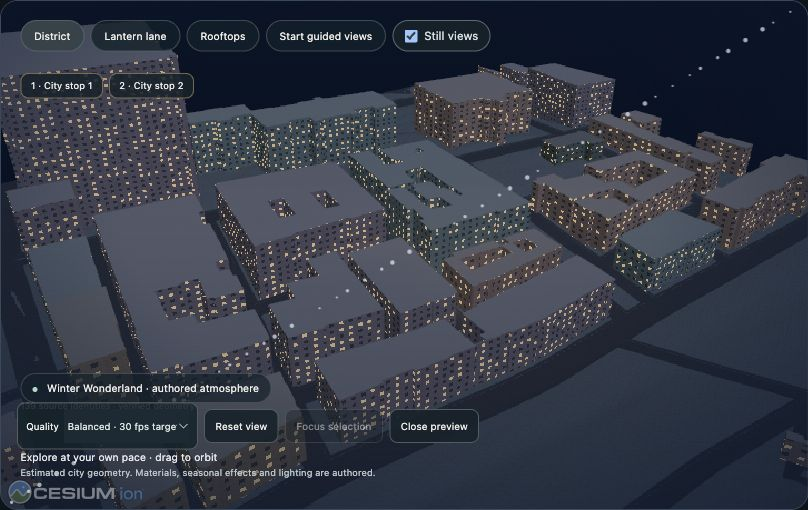
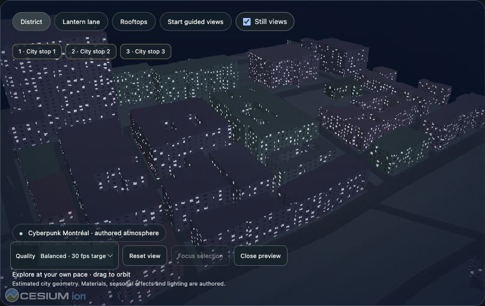
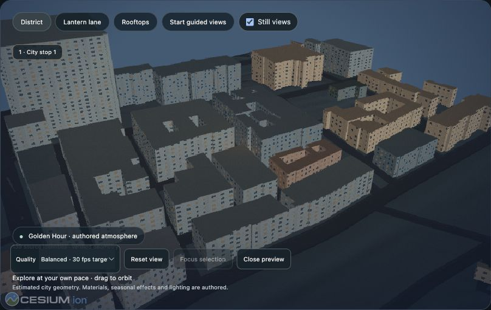
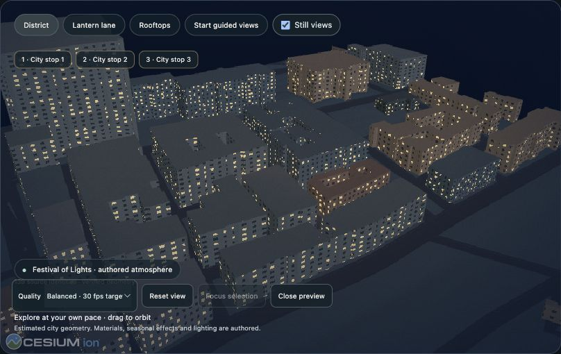
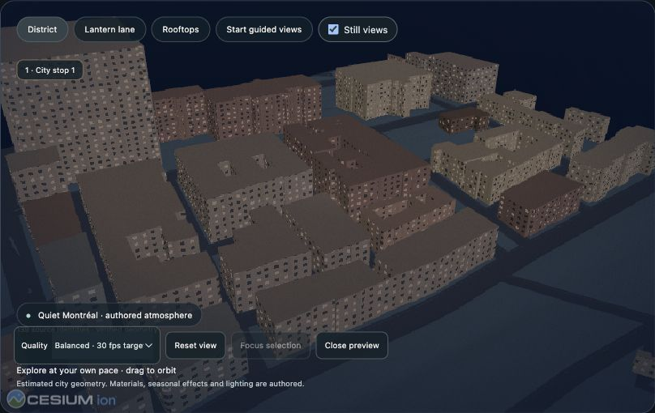

# M5 visual regression gallery

Same District viewpoint, balanced quality, Still views enabled. These are direct native screenshots of the actual Cesium scene, clipped at capture time without image editing. The 139 source identities/geometry remain fixed. Facades, windows, lighting and atmosphere are authored; simplified city forms may be estimated. Audio descriptions below refer to mixes of the same approved original synthesized assets.

| Experience | Actual composition |
| --- | --- |
| Winter Wonderland | Festival light, warm stone/windows, authored snowfall, soft score, two stops, District / 12 s optional guide cadence |
| Cyberpunk Montréal | Cool neon/metal, strong haze, prominent electronic score/chimes, three stops, Lantern lane / 8 s |
| Golden Hour | Daylight-inspired directional highlights, clear softer materials, quiet mix, no street-light pairs, Rooftops / 14 s |
| Jazz Night | Restrained warm nighttime light, music-forward original synth mix, two stops, Lantern lane / 22 s; no jazz recording |
| Festival of Lights | Bright windows, street-light pairs, prominent score/chimes, three stops, District / 10 s |
| Quiet Montréal | Low glow/haze, very soft audio option, no street-light pairs, one stop, Rooftops / 28 s |

## Winter Wonderland

## Cyberpunk Montréal

## Golden Hour

## Jazz Night

## Festival of Lights

## Quiet Montréal

