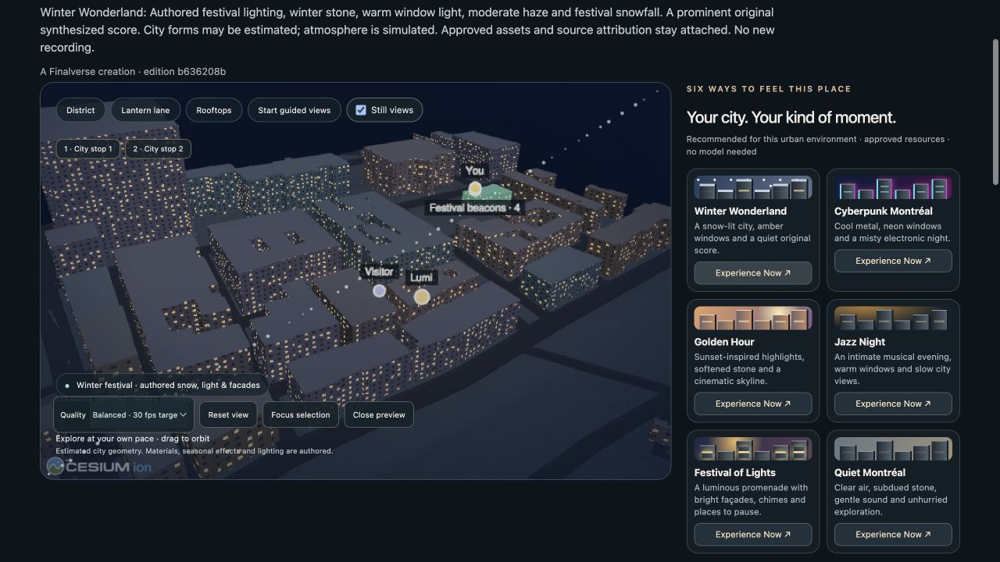

# M6-A → M6-B web delivery

Built on accepted M5 Earth Web `c2c294131af229bb481be3037f7a3384a7da0d3e`, paired with local Core commit `1426227b22283d4c7ab3addb74310924058b4304`. Nothing was merged, pushed or publicly deployed.

The existing Cesium player now navigates from an offline Earth overview through Montréal to the source district, resolves an immutable publication's placement, joins a bounded MutSea experience instance, shows other visitors and Lumi, focuses selected source geometry, proposes an approved shared beacon, and presents actual committed receipts. Invitations open the same immutable edition. Guest personalization and sharing continue to work standalone without a world host.



## Verified

- The automated **20-step journey passed in Chromium and Safari**, using independent browser storage/process contexts and actual MutSea TCP sessions.
- **30 Node tests** passed, including immutable invitation validation and affected publication/guest compatibility checks.
- Core verified **49 real HTTP checks**, **507 sealed evidence checks**, **110 WorldLine records**, and zero owned sessions after shutdown.
- Final browser join: **57.1 ms**; selection: **52.6 ms**; offline place response: **3.9 ms**; authoritative beacon: **58.1 ms**. Remote projection p95 over 20 HTTP presence updates: **54.7 ms**.
- Cold simultaneous rendering previously exceeded selection/guide targets; that separate evidence is retained. Warm results are not presented as first-time-user guarantees.
- Optional real local Ollama inference used `qwen2.5-coder:3b`, 916 input / 262 output tokens, **22.006 s**, no fallback, and applied nothing automatically.
- A **390 × 844** standalone host without MutSea rendered all **139 identities**, had no horizontal overflow, and completed guest personalization, save and temporary sharing. Preview close released owned rendering/audio/async resources.
- **139 source identities and 143 approved assets** remain pinned. Accepted M5 and other protected worktrees remain clean and unchanged.

## Reproduction and limits

Build with the existing installed Cesium 1.138.0 dependencies:

```sh
FEN_EARTH_DEPENDENCIES=/Users/wenyan/Finalverse/earth-web/node_modules node experience-player/build.mjs
node --test experience-player/m6.test.mjs experience-player/test/protocol.test.mjs experience-player/test/m4c-contract.test.mjs experience-player/test/m5.test.mjs
```

`experience-player/review-living.mjs` runs inside CUA with a fresh Chromium tab and an owned Safari tab. Its actions cover join, source selection, grounding, guidance, shared mutation, refusal, disconnect/reconnect, receipt correlation and cleanup. It does not mock the multiplayer backend. The Core report and reproduction instructions are at `/Users/wenyan/Finalverse/dev/worktrees/core-m6-20261029/docs/m6/`.

This is a local vertical slice. The beacon is an approved persistent marker rather than photometric lighting. Earth/Montréal are geographic presentation scales rather than an arbitrary-scale simulation. The SpatialDB context is a verified immutable catalog snapshot. Public networks, production identity, cloud continuity and physical mobile devices remain unverified. M6-owned preview servers and browser tabs were stopped; the earlier M5 preview and user-owned Ollama service remain untouched.
