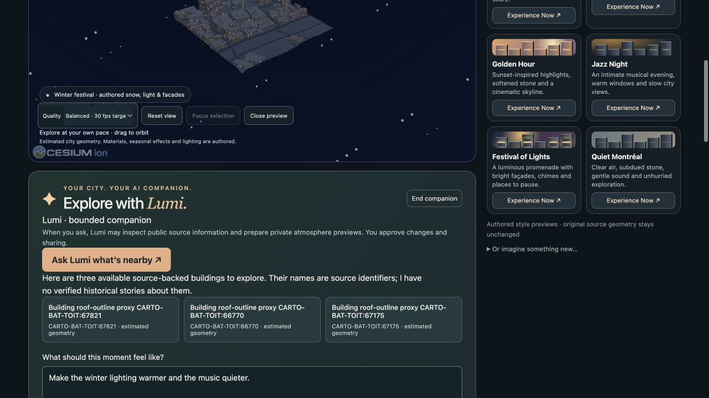
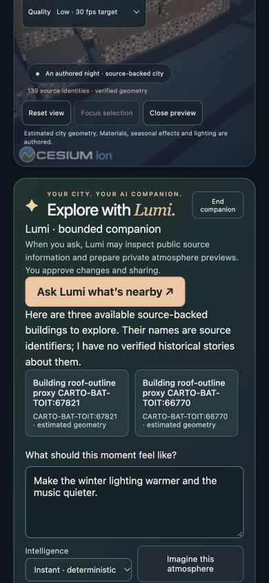

# M7 Montréal Alive browser acceptance

The accepted M6 player now includes a bounded Lumi companion. It inspects actual source entities, navigates to a selected anchor, prepares a private atmosphere with deterministic or real local intelligence, previews an exact proposal, requests human approval and creates a temporary share only after separate consent. Source geometry stays visibly distinguished from authored presentation.

The browser composer resolves the original and Winter Wonderland publication pins without asset copies. Its two inspection buttons use independent EK attachments. A temporary shared parent can compose the same two durable editions. Ending the companion clears its child controls and releases server scopes; closing the preview releases scene resources. Optional shared-world beacon review pins the chosen source anchor and uses a separately authorized MutSea receipt.

CUA verified Chromium at 1280 × 720 and 390 × 844. The phone-width page measured 390 px document width with no horizontal page overflow. All 139 source identities rendered, and grounded recommendations and private preview worked at that width. This is viewport testing on a Mac, not an iPhone/Android device result. Safari's accepted M6 evidence was not rerun as an M7 claim.

All 37 existing player/placement Node tests, JavaScript syntax checks and the local pinned-Cesium build passed. Browser evidence also records a real Ollama proposal (21.912 seconds, one attempt, no fallback), real inference cancellation, private apply, explicit temporary sharing and recipient planning. No cloud endpoint was called.

Core worktree: `core-m7-20261029`, branch `feat/m7-adaptive-intelligence`. Its `docs/m7` contains contracts, provider/security guide, composition example, reproducible HTTP and evidence-verification scripts, measured performance and sealed acceptance evidence. The starting browser commit is `ac545e8cc43465aace0cac9633d54f38301fc036`; delivery remains local, unmerged and unpushed. Owned M7 test services/tabs were stopped; the pre-existing M5 preview and user-owned Ollama were preserved.
