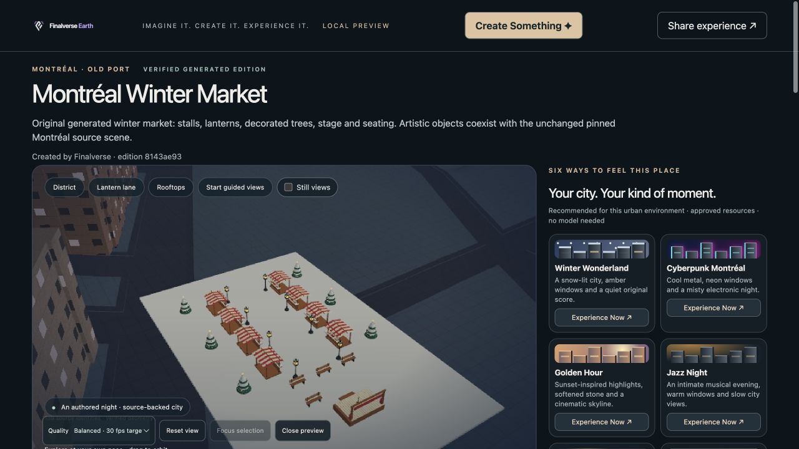
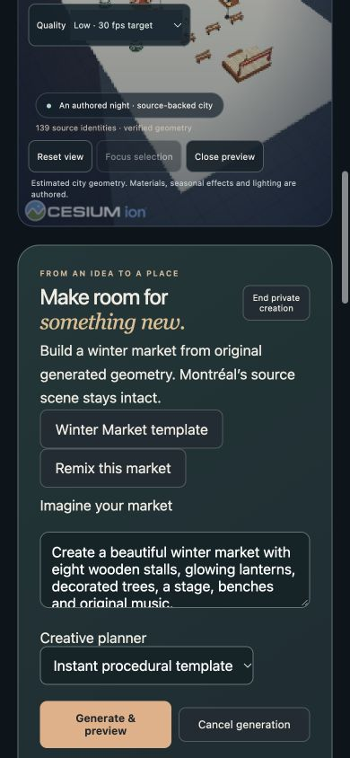

# M8 — Montréal Winter Market browser acceptance

Baseline: `b443ecdf0d9b20b4e57738eafcbff8ae2158932a`. Worktree: `/Users/wenyan/Finalverse/dev/worktrees/earth-web-m8-20261030`, branch `feat/m8-winter-market`. This integrates with the isolated Core M8 worktree based on `453ff2aaf0ae41519f40cf84af251783d50cedae`.

The existing **Create Something** entry opens a private world-creation panel. A deterministic Winter Market template, configured local planner or remix produces new validated GLBs through the existing capability fabric. The default template contains eight stalls, six decorated trees, eight lanterns, four benches, one stage and one snow plaza: **28 objects** alongside the unchanged **139 source entities**. Generated models are visibly labelled and separately inspected.

The actual Chromium workflow verified generation, preview, selection, inspection, individual material modification, an EK-authorized lantern toggle, exact-graph approval/save, explicit publication, sharing, fresh recipient reopening and a private remix. Existing publisher credentials are required for publication and remain in document memory. Public recipient rendering requires no creator credential or capability attachment. Separate GLB and manifest downloads were exercised; a complete scene export also needs every referenced GLB. Approved original audio starts only after an explicit play action. The lantern uses a fixed host-owned emissive shader after the typed capability succeeds.

The final shared edition is `montreal-after-dark@8143ae9315d57a9fa740a6322e108488815d335ddaec15054f71ae8e31dacdc5`. Its graph hash is `1fa9b22ecb6c89e80820a46c30bd6f05a7f91848434ddf0257aeb778c2e7a010`. The local runtime is stopped; use the Core reproduction instructions to reopen it.

**39 Node tests passed**, including the two new M8 publication/integrity tests. The pinned Cesium 1.138.0 player build passed with retained Node 22.18.0 dependencies. Tests reject generated graph/hash tampering and source identity collisions while preserving legacy publication compatibility. The complete accepted M7 acceptance suite was not repeated.

Recorded browser measurements on the same Apple M1 Mac:

| Workload | Observation |
| --- | --- |
| Final recipient's first generated geometry | 94.7 ms after generated-layer load starts, with the source renderer initialized |
| Phone-width private remix's first geometry | 161.8 ms after Remix |
| Phone-width lantern capability round trip | 1.9 ms, one sample; excludes GPU display latency |
| Recipient renderer CPU submission | p95 5.6 ms across 5 samples |
| Phone-width renderer CPU submission | p95 26.4 ms across 6 samples |
| Phone-width active rAF intervals | p95 18.3 ms across 180 samples; not GPU timing |
| JS heap snapshots | 112.3 MB recipient / 66.4 MB phone-width remix; not peak memory |

The 390×844 layout had a 390 px document width without horizontal overflow. This is Mac Chromium viewport testing, not physical-device or Safari verification. Teardown returned source and generated models, object URLs, owned shaders, audio sources/contexts, observers and animation callbacks to zero; no pending generation or active attachment remained. M8's loopback runtime and task-owned browser tabs were closed.

The Core report at `/Users/wenyan/Finalverse/dev/worktrees/core-m8-20261030/docs/m8/acceptance.md` contains geometry inventory, AI receipts, SpatialDB and Blender evidence, authorization results, test logs and known limits. Exact local commits are recorded in `/Users/wenyan/Finalverse/dev/m8-20261030/delivery.json`. No merge, push or deployment occurred.
