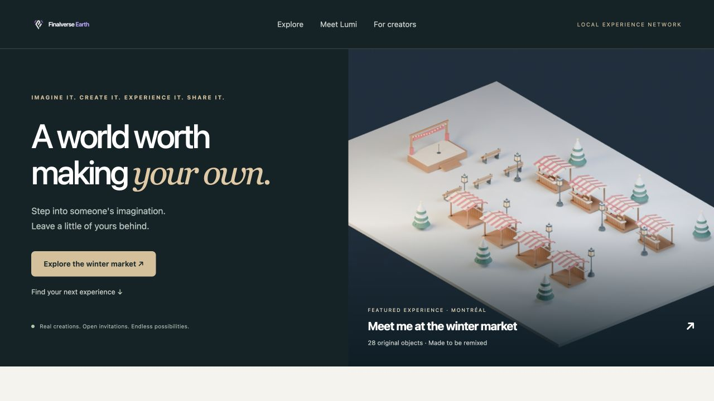
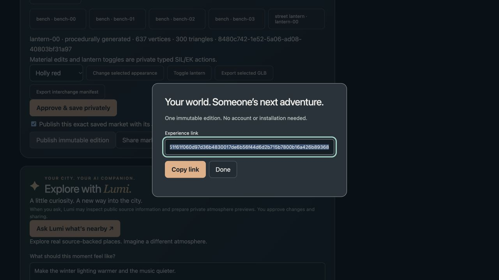
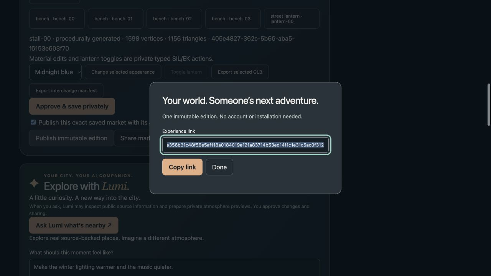
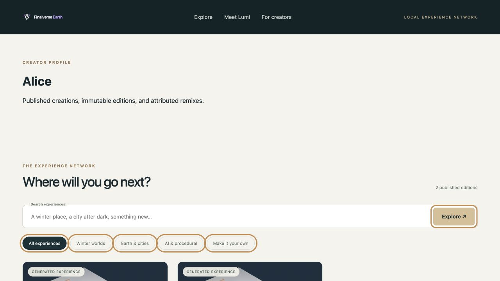
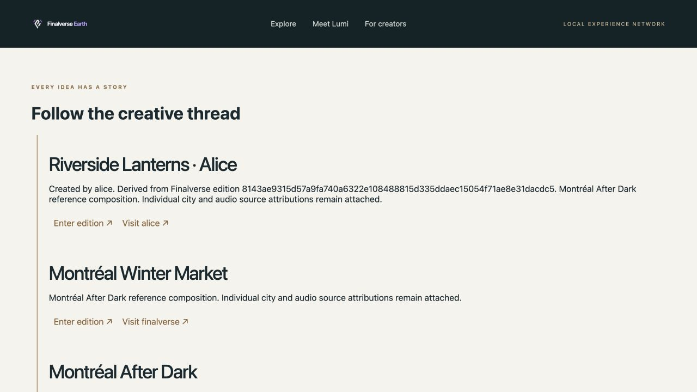
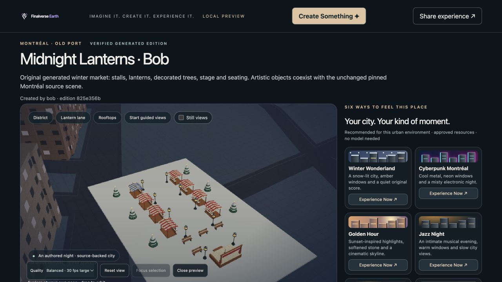
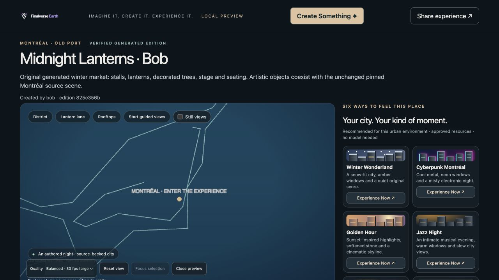
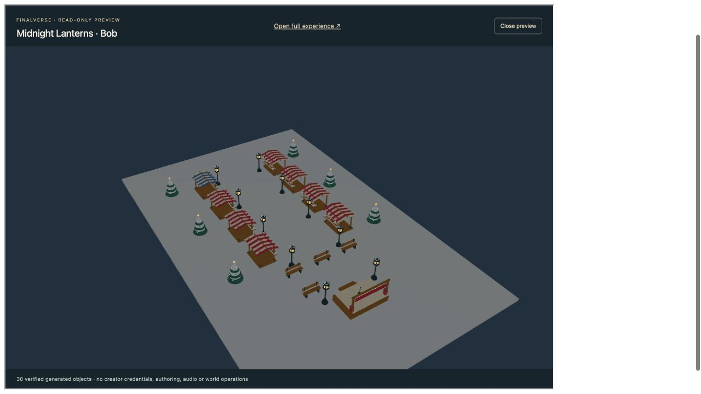
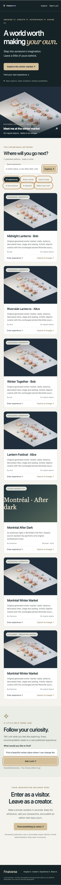

# M9 — Discovery and creator network: browser acceptance

Delivered locally on 2026-10-31 (Asia/Shanghai), from accepted Web baseline `f349833a797ff655188c8ea59cbdf09211c472b0` in `/Users/wenyan/Finalverse/dev/worktrees/earth-web-m9-20261030`, branch `feat/m9-discovery-network`. The matching Core baseline is `95483af592dfa03b9fbeb3b847f67ddc33b2451b`; SpatialDB remains unchanged at `637a4340019854b10bf518e18d6e56bd34878ada`.

The homepage lists actual published editions, supports search/category/creator/AI/remix filters and recommends real destinations through bounded Lumi registry reads. The experience panel adds local recoverable creator identity, private festive remix, separate save/publication consent, creator profiles, navigable immutable lineage, source-anchored Earth links, package export/import and visibility/report controls. The real read-only embed uses the same immutable edition's verified GLBs with no creator attachment or authoring controls.

## Browser proof

The imagery is rendered from the actual accepted 28-object M8 Winter Market geometry. See `experience-player/network-assets/provenance.json` for source and output hashes. Variant cards explicitly disclose that the original template preview can differ from the edition.

Alice discovered the market, interacted with a generated lantern and published **Riverside Lanterns · Alice** (`c7f28951f61f060d97d36b4830017de6b56f44d6d2b715b7800b16a426b89368`). Bob opened that link without credentials, inspected attribution/profile/lineage, remixed one stall material and published **Midnight Lanterns · Bob** (`825e356b31c48f56e5af118a0184019e121a83714b53ed14f1c1e31c5ac0f312`). Both retain exact immutable parents and separate creator-owned definition IDs.

After service restart, the exact editions and their ancestry persisted. Bob's scene rendered **139 source models plus 30 generated models**, without a creator login. The blue stall material remained intact. Browser package download matched a later deterministic export byte-for-byte (10,227,857 bytes, SHA-256 `f99601a7264222edf65d40d2cedb60b0cf09e8197fe08f55a58851cf8e4d6792`).

A 390 × 844 viewport test found document/body/viewport widths of 390 pixels, with no horizontal overflow. Desktop browser evidence used 1280 × 720; the final restored preview also worked at the app's narrower default viewport. Responsive checks use Chromium, not a physical-device certification.

## Validation and measurements

All **41 JavaScript tests** pass, including strict standalone/Earth context parsing and rejection of substitution, duplicate or malformed query parameters. The build passes with existing Node 22.18.0 / Cesium 1.138.0 dependencies, without a network install. Matching Core verification passes **43 targeted Rust tests**, Clippy, formatting and release build.

Alice's operator discovery-to-share browser journey took **68.536 seconds**, measured from the already loaded homepage feature click to the permanent share dialog with a provisioned local identity. Her first/all source geometry loaded in 613/1,476 ms; Bob's in 313/1,315 ms. Browser plan/generate/preview took 14.7/19.2/4.6 ms for Alice; publication took 128.4 ms for Alice and 119.5 ms for Bob. The post-restart sample measured 180 rAF intervals, p95 17.6 ms (~60 rAF/s). These are local measurements, not WAN, novice signup, GPU or production capacity claims.

Close releases source/generated models, blob URLs, shaders, viewers, audio resources, render observers and attachments. Final network diagnostics show no creator session, download URLs or timers. The embed closed from 30 models / 30 URLs / one viewer to 0 / 0 / no viewer. The temporary viewport was reset, task tabs closed and owned preview servers stopped.

An additional early-close check started while immutable assets were still being verified. Pending work settled with zero models/URLs/viewer and no console errors; late asynchronous loads cannot recreate the viewer after Close. Normal loading and closing of all 30 edited market objects was rechecked after that fix.

The [Core acceptance report](/Users/wenyan/Finalverse/dev/worktrees/core-m9-20261030/docs/m9/acceptance.md) contains exact APIs/migration, raw browser diagnostics, HTTP restart/import/security evidence, measured latencies, preservation checks and limitations. Follow its [reproduction instructions](/Users/wenyan/Finalverse/dev/worktrees/core-m9-20261030/docs/m9/reproduction.md) to restart locally.

Local operator-provisioned identity, same-origin embedding and the public archive profile are the delivered scope. Public SSO, hosted availability, cross-origin embedding, private invitation UI, authoritative generated world objects, cross-device continuity and native/Safari acceptance remain future work. M9 deterministic discovery/remix does not claim a new local-model inference run. No merge, push, public deployment or M10 work occurred.
